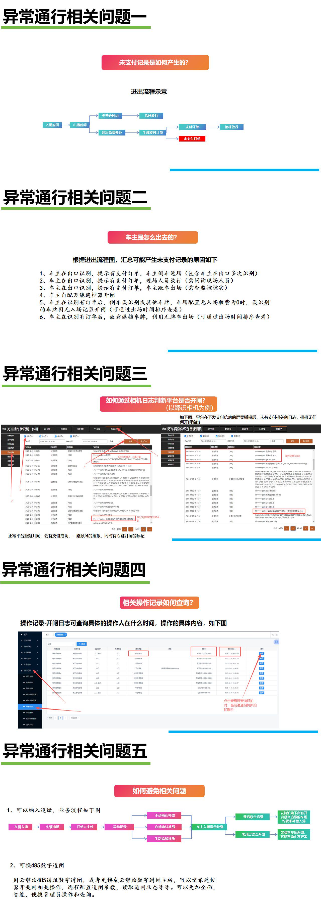

# 4.6 异常通行问题排查

本页汇总异常通行场景中常见问题的产生原因、排查方法及预防措施。

## 常见问题

1. **未支付记录是如何产生的？**
   车辆出场时系统未成功扣费，或车主离场后才补缴，均可能产生未支付记录。

2. **车主是怎么出去的？**
   常见原因包括：跟随前车、撞杆、谎称已缴费、万能遥控器、篡改车牌、返场逃费等。

3. **如何通过相机日志判断平台是否开闸？**
   可在操作记录中查看相机日志与开闸指令，核对开闸时间、车牌识别结果及操作人。

4. **如何避免相关问题？**
   建议开启联合追缴、黑名单、全局补缴等功能，并定期检查设备识别准确率。

