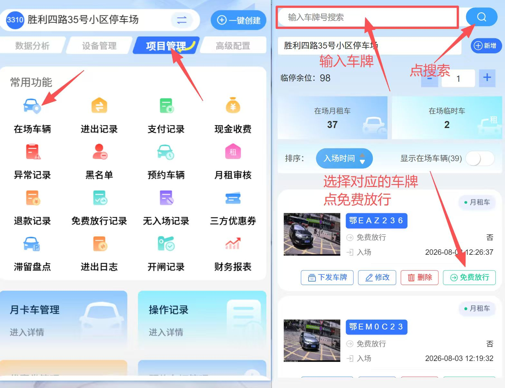

# 4.7 小程序在场车辆免费放行

本页介绍管理员如何通过手机小程序，快速查询在场车辆并执行免费放行操作。

## 操作步骤

1. 打开小程序，进入 **项目管理 → 在场车辆**。
2. 在搜索框中输入车牌号，点击「搜索」。
3. 在搜索结果中选择对应的车辆记录。
4. 点击「免费放行」按钮，即可完成放行。

:::tip
免费放行适用于临时接待、内部车辆、故障车等特殊场景，操作后可在免费放行记录中查询。
:::

