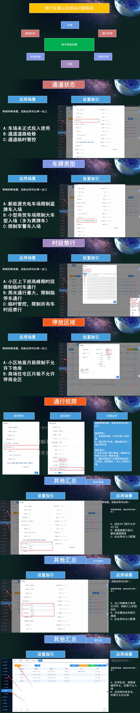

# 4.8 停车位计量与授权规则配置

本页介绍停车Boss系统中停车位计量、通道状态、车牌类型、时段禁行、停放区域及通行权限等高级授权规则的配置方法。

## 配置场景

- **通道状态**：设置车道是否启用、是否允许双向通行。
- **车牌类型**：按车辆属性（如新能源、警车、货车等）设定不同通行策略。
- **时段禁行**：在指定时间段内限制部分车辆进出。
- **停放区域**：限制车辆只能在指定区域内停放。
- **通行权限**：按部门、车主、车辆类型分配差异化权限。

管理员可在 **车场配置 → 收费配置/车辆配置** 中按需启用上述规则，并保存生效。

