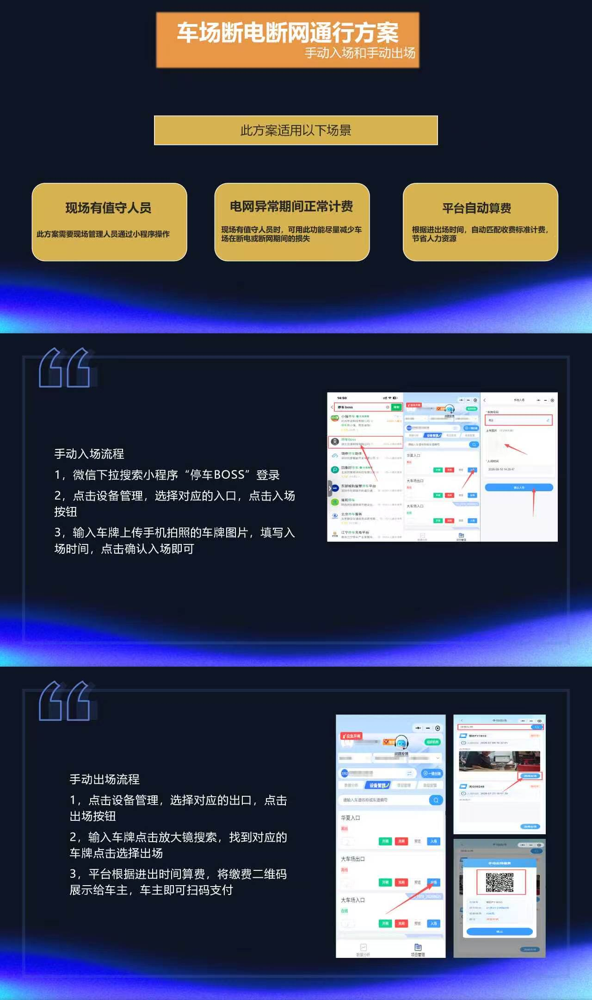

# 4.9 断电断网手动通行方案

本页说明停车场在断电、断网等异常情况下，管理员如何通过小程序手动完成车辆入场与出场，保障正常通行。

## 适用场景

- 现场有值守人员，需要人工干预通行。
- 电网异常期间仍需正常计费，减少损失。
- 平台根据进出时间自动算费，节省人力资源。

## 手动入场流程

1. 微信搜索小程序「停车Boss」并登录。
2. 进入 **设备管理**，选择对应的入口设备，点击「入场」按钮。
3. 输入车牌号并上传现场照片，填写入场时间后确认。

## 手动出场流程

1. 进入 **设备管理**，选择对应的出口设备，点击「出场」按钮。
2. 输入车牌号搜索，找到对应车辆后选择「出场」。
3. 平台根据进出时间自动算费，展示缴费二维码，车主扫码支付后离场。

