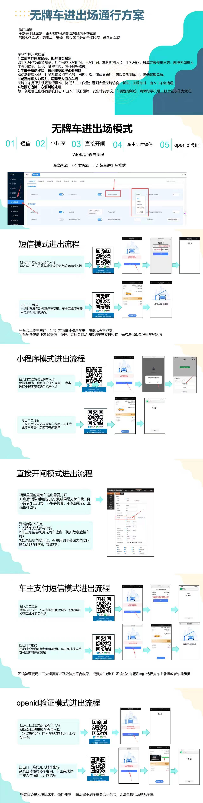

# 4.10 无牌车进出场通行方案

本页介绍无牌车辆进出停车场的五种通行模式，帮助车场管理员根据实际场景选择最合适的放行方案。

## 五种通行模式

| 模式 | 说明 | 适用场景 |
|---|---|---|
| 短信模式 | 车主扫码输入手机号，系统发送短信开闸 | 临时访客 |
| 小程序模式 | 通过微信小程序完成无牌车登记与缴费 | 常用车主 |
| 直拨开闸 | 岗亭人员手动确认后开闸 | 内部车辆 |
| 车主支付短信 | 出场前发送缴费短信，车主完成支付 | 无人值守 |
| openid 验证 | 绑定微信 openid 后自动识别放行 | 高频访客 |

每种模式的具体开通与设置方式可参考下方流程图。

