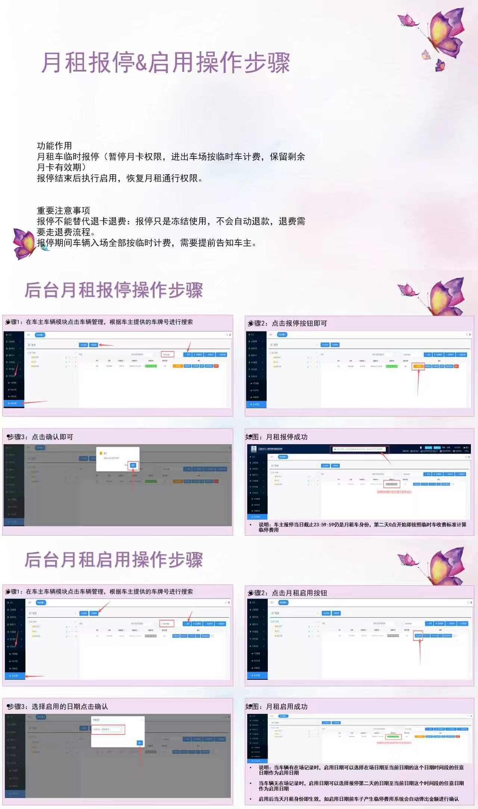

# 4.11 月租报停与启用

本页介绍月租车临时报停与重新启用的后台操作步骤，以及报停期间的计费规则。

## 功能作用

月租报停可临时暂停月卡通行权限，车辆在报停期间按临时车计费，同时保留剩余有效期。报停结束后执行启用，恢复月租通行权限。

## 重要注意事项

- 报停仅冻结使用，不会自动退款；如需退费请走退费流程。
- 报停期间车辆入场全部按临时车计费，需提前告知车主。

## 后台操作步骤

### 月租报停

1. 进入 **车场业务 → 车辆管理**，搜索目标车牌。
2. 点击「报停」按钮。
3. 在弹窗中确认报停信息，点击「确认」。
4. 报停成功后，车辆状态会相应更新。

### 月租启用

1. 在车辆管理中找到已报停车辆。
2. 点击「月租启用」按钮。
3. 选择启用日期并确认。
4. 启用成功后，车辆恢复月租权限。

