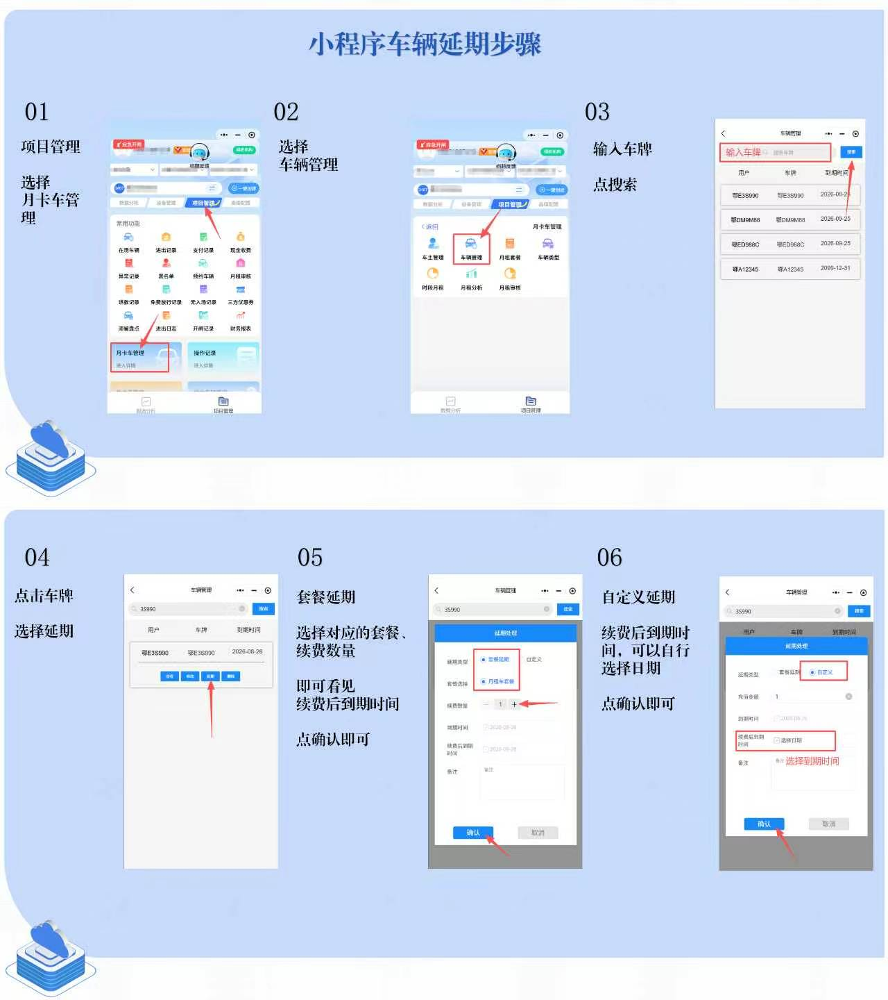

# 4.12 小程序车辆延期

本页介绍如何通过微信小程序为月租车办理续费延期，支持套餐延期和自定义延期两种方式。

## 操作步骤

1. 打开小程序，进入 **项目管理 → 月卡车管理 → 车辆管理**。
2. 输入车牌号并点击「搜索」。
3. 在结果列表中点击目标车牌，选择「延期」。
4. 选择延期方式：
   - **套餐延期**：选择对应套餐与续费数量，确认后系统自动计算到期时间。
   - **自定义延期**：输入充值金额或选择新的到期时间，确认即可。
5. 核对延期信息无误后点击「确认」，完成续费。

