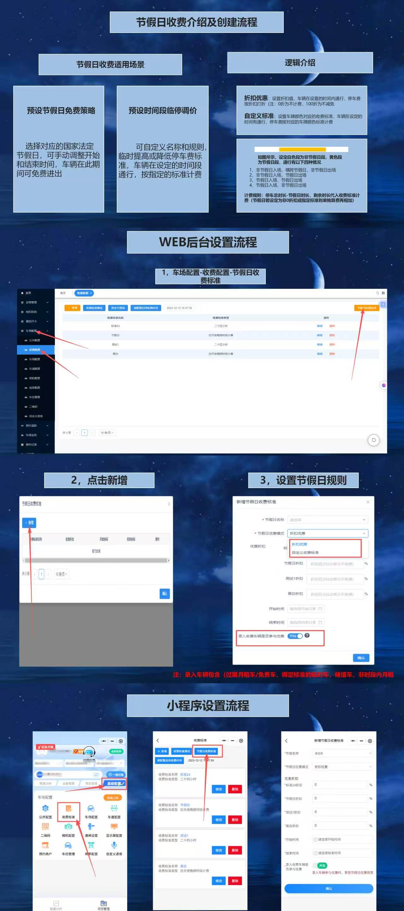

# 4.13 节假日收费规则设置

本页介绍节假日收费策略的适用场景、计费逻辑，以及在 WEB 后台和小程序端的设置流程。

## 适用场景

- **节假日免费**：在法定节假日期间，车辆可免费进出。
- **临停调价**：在特定时间段内临时提高或降低临停收费标准。

## 后台设置流程

1. 进入 **车场配置 → 收费配置 → 节假日收费标准**。
2. 点击「新增」，填写节假日名称、适用日期、计费规则。
3. 保存后，该规则将在指定日期自动生效。

## 小程序设置流程

管理员也可通过小程序进入收费配置模块，完成节假日规则的查看与快速调整。

