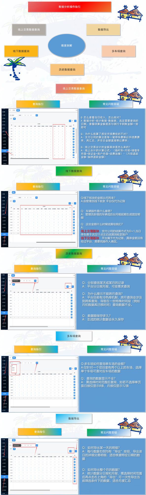

# 4.14 数据分析操作指引

本页介绍停车Boss数据分析模块的使用方法，包括线上交易、线下数据、历史数据、多车场查询及数据导出等功能。

## 功能模块

- **线上交易数据查询**：查看车主通过微信、支付宝等线上渠道支付的交易记录。
- **线下数据查询**：查看现金、POS 机等线下收款记录。
- **历史数据查询**：按日期、车场、车牌等维度查询历史停车记录。
- **多车场查询**：针对多个车场进行统一数据汇总与分析。
- **数据导出**：将查询结果导出为 Excel 等格式，便于对账与存档。

每个模块都提供筛选条件、常见问题答疑及导出按钮，管理员可按需查询。

