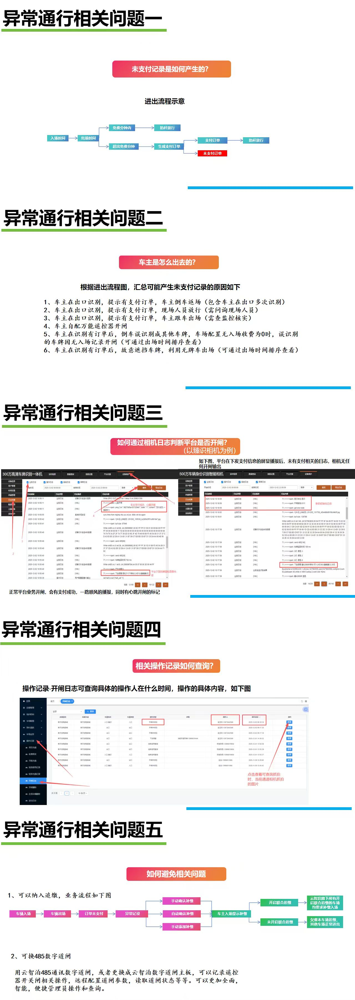

# 4.15 异常通行相关记录查询

本页重点说明异常通行发生后，如何在系统中查询相关操作记录、开闸日志及处理痕迹，便于追溯与对账。

## 查询入口

1. **操作记录**：可查看每一次人工开闸、修改、删除等操作的详细日志。
2. **相机日志**：核对车辆识别时间、识别结果及平台是否下发开闸指令。
3. **异常记录**：查看未支付、逃费等异常订单的处理状态。

## 查询方法

选择目标日期范围或输入车牌号，系统会列出所有匹配记录，包含操作人、操作时间、操作内容等关键信息，方便事后审计与责任追溯。

