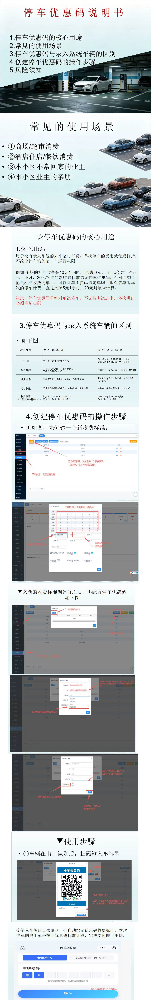

# 4.16 停车优惠码使用

本页介绍停车优惠码的核心用途、常见使用场景、与录入车辆的区别、创建步骤及使用流程。

## 核心用途

停车优惠码用于为临时车辆提供停车费减免，适用于商场、超市、餐饮等商业场景，以及小区业主亲友来访等场景。

## 与录入车辆的区别

| 项目 | 优惠码 | 录入车辆 |
|---|---|---|
| 使用方式 | 扫码输入车牌自动减免 | 系统识别车牌自动放行 |
| 适用对象 | 临时访客 | 固定车主/月租车辆 |
| 费用结算 | 按优惠规则即时减免 | 按车辆类型计费 |

## 创建与使用步骤

1. 在后台创建优惠码，设置减免金额或免费时长。
2. 将生成的二维码张贴到入口或收银台。
3. 车主扫码后输入车牌，离场时系统自动按优惠规则计费。

