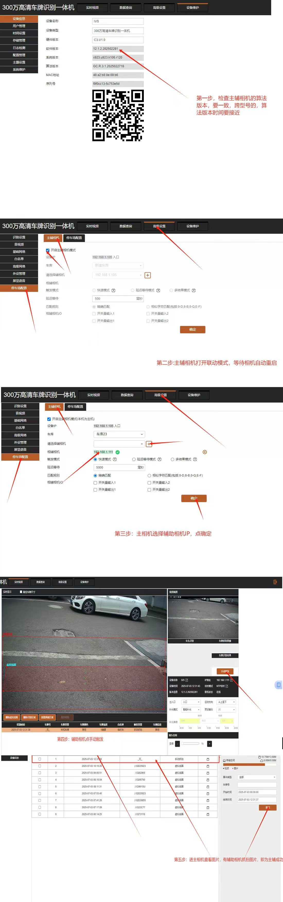

# 4.18 车牌识别一体机配置

本页介绍 300 万高清车牌识别一体机的主辅相机联动配置步骤，帮助管理员完成设备调试。

## 配置步骤

1. **检查算法版本**：登录相机后台，确认主辅相机算法版本一致。
2. **打开联动模式**：在主辅相机设置中开启联动模式，等待相机自动重启。
3. **配置辅助相机 IP**：在主相机中选择对应的辅助相机 IP 地址并确认。
4. **触发辅助相机**：通过线圈或视频触发辅助相机抓拍。
5. **调焦验证**：现场观察抓拍图片，确保车牌清晰、识别准确。

