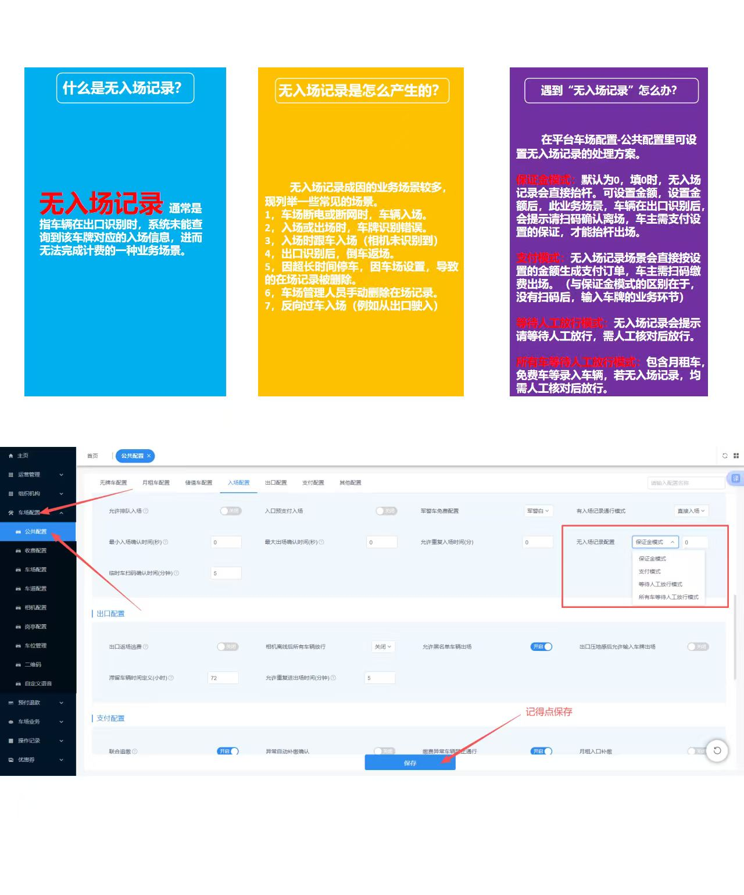

# 4.19 无入场记录处理

本页介绍无入场记录的产生原因、业务场景及处理方法，帮助管理员正确配置出场规则。

## 什么是无入场记录

无入场记录指出口识别到车辆时，系统未查询到对应入场信息，导致无法正常计费的业务场景。

## 常见产生原因

1. 车场断电或断网时车辆入场。
2. 入场或出场时车牌识别错误。
3. 入场时跟车入场，相机未抓拍。
4. 出口识别后车辆倒车返场。
5. 超长时间停车，在场记录被自动清理。
6. 管理人员手动删除在场记录。
7. 反向过车入场（例如从出口驶入）。

## 处理方式

在 **车场配置 → 公共配置 → 无入场记录配置** 中，可选择：

- **保证金模式**：设置金额，车主需扫码缴纳保证金后出场。
- **支付模式**：按设定金额生成支付订单，车主缴费后出场。
- **等待人工放行模式**：提示岗亭人员人工核对后放行。
- **所有车辆等待人工放行模式**：所有无入场记录车辆均需人工确认。

