停车Boss无人值守停车管理系统使用说明书

本说明书系统介绍无人值守系统的登录、首页、组织机构、车场配置、车场业务、优惠券、数据分析与预约车辆等全部功能模块。

## 一、登录系统

1、输入登录地址

打开浏览器 `<平台登录地址>`（由服务人员提供）登录系统首页，如图所示：

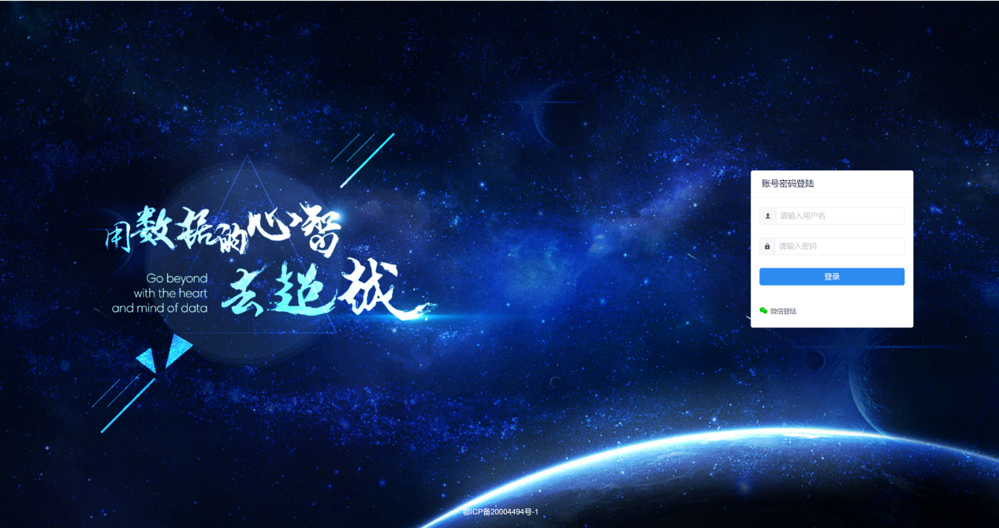

- 输入登录账号

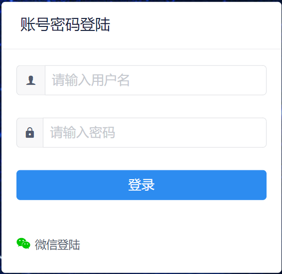

## 二、首页

首页通过可视化的方式展示车流量，收入以及各类统计组成；从近一周，近30天的维度进行车流量，相关收入以及车场车次分析、新能源时段停留划分进行统计，使管理者对车场的运营情况一目了然。

## 三、组织机构

### 1、集团管理

可新增、修改、查询、删除集团，在集团下新建角色，创建账号

新增集团，填写集团账号信息，设置年费价格；在账号申请表格里面有对公、对私账户，申请后支付类型选择对应数据填写

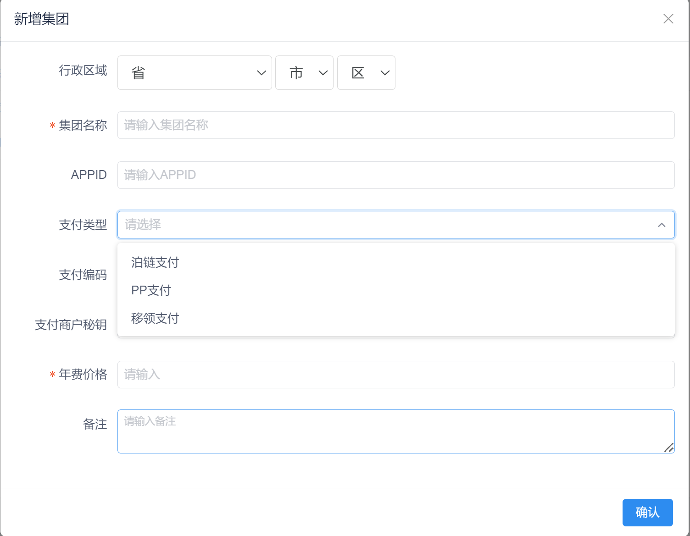

#### 新建集团角色，角色权限不勾选默认所有权限

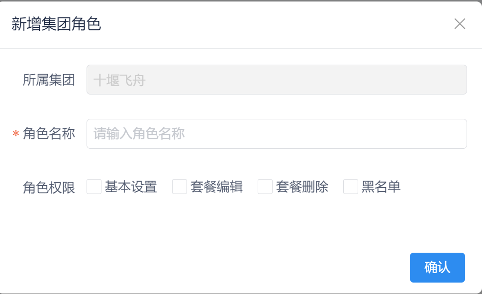

（3）新增集团账号，选择上一步创建的角色，输入必填项，点击确认

### 2、分公司管理

可新增、修改、查询、删除分公司，创建分公司角色和账号。

创建分公司，选择上一步填写的集团名，输入分公司名称，点击提交

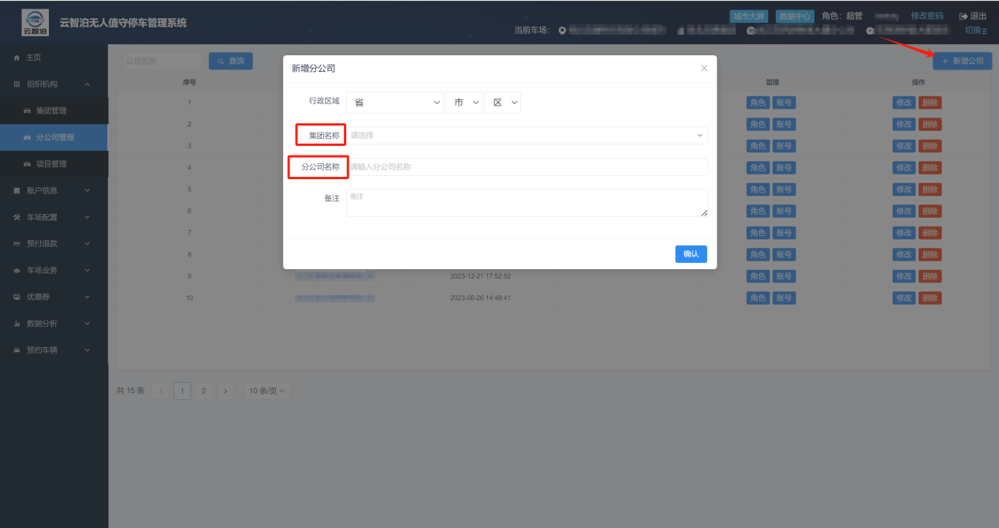

### 3、项目管理

可操作新增、修改、查询、删除项目，创建项目角色和账号

（1）创建项目，选择集团、分公司，选择支付平台，填写支付编码，年费价格

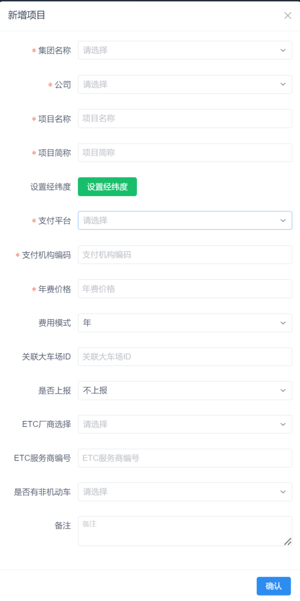

#### （2）添加角色、权限分配、新增账号

每个分级权限可新增角色与账号的意义在于鼓励经销商客户让自己的客户自己管理车场，发展下级。

## 四、账号信息

充值记录

查看下级所有项目线上、线下充值、申请提现、已结算记录，城市、集团账号可操作提现。

## 五、车场配置

### 1、公共配置

公共配置包括无牌车、月租、出入场、支付、其它配置等

#### 无牌车配置

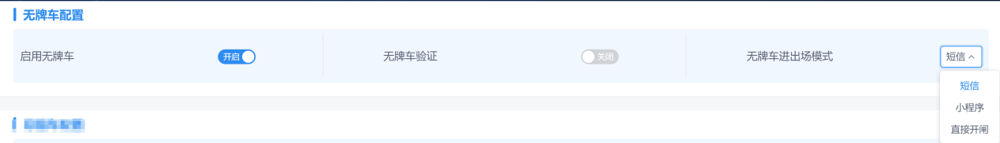

- **启用无牌车**：开启后，无牌车可以选择扫码进出场

- **无牌车地感验证**：开启后现场有真实有效车辆才可触发无牌车开关，通过扫码不能直接开闸，避免车主用手机扫码输入，不存在车辆进场

- **无牌车进出场模式**：小程序、短信、直接开闸三种模式，默认短信。小程序、短信均按0.1元/条收费，平台免费提供100条，后续自费。直接开闸，无牌车免费进出。

#### （2）月租车配置

- **月租车满位入场**：开启后，在车场无余位情况下，月租车仍可以正常入场

- **自动删除过期月租车**：默认开启，3个月，超过设置时长，自动删除月租车

- **月租车申请**：开启后，车主可自行扫车场月租申请码登记上报月租车信息，操作界面如下图：

- **月租超位模式**：在一位多车情况下，第二台（或者多台月租车）要进车场，可选全程按临时车收费或场内转月租

#### 入场配置

- **允许排队入场**：默认开启，车场车位已满的情况，车辆可在入口等待，出口有车出去后，入口不用倒车，自动开闸。

- **最小入场确认时间**：针对单通道，出场时避免车速过慢或车辆抖动重新识别尾部车牌，造成异常开闸

- **最大出场确认时间**：包含上述情况外，避免出口相机一直识别离出场口较近停车位，造成异常开闸。还有一种情况，刚刚入场就到出口识别，造成误识别，异常开闸。

- **未入场缴费**：没有入场纪录，预支付指定保证金

- **临时车扫码确认时间**：设置扫码时间支付，超时订单失效需重新扫码

- **允许重复进出场**：车辆重复进出场，例如，车辆缴费后，道闸开闸时间已过，落闸后，车辆后退重新识别又可重新开闸。举例：商户住店车在住店时间内可重复进出场。

#### 出场配置

- **出场返场逃费**：车辆入场后又到出口识别，再倒车停到车位；未开启此功能时会丢失入场记录，提示无入场记录，此时系统提示请缴纳保证金出场。如不开启保证金模式则直接免费出场。

- **允许黑名单车辆出场**：在场黑名单车辆允许出场

- **相机离线后所有车辆放行**：默认不开，离线后管理员可用手机登录公众号，人工拍照上传照片进出。（此场景应对断电，断网状态）

- **出口压地感后允许输入车牌出场**：此功能为设置为扫码出场使用。避免利用相机识别照片错误开闸。

- **滞留车辆时间定义**：入场超过设定时间，自动把该车辆归类于滞留车辆，可手动盘存。该车辆不占用车场余位。

#### 支付配置

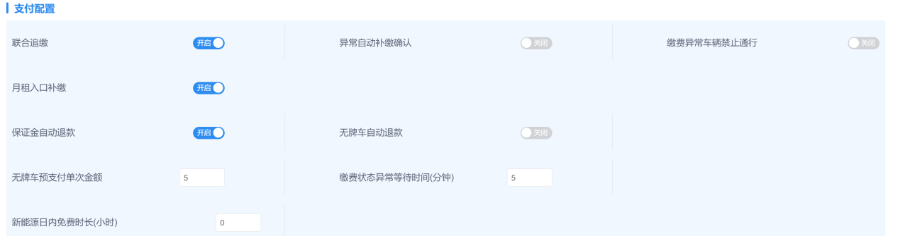

- **联合追缴**：此功能已经下放到所有等级车场，在同一账号下，A停车场逃费记录，上传云平台该城市所有车场可入口补缴该笔费用。金额回到A停车场账户。

- **异常自动补缴确认**：开启后会弹出自动补缴确认金额，小于等于填写的金额自动进入补缴后台，车辆再进入车场需补缴上次欠费订单后入场。

- **缴费异常车辆禁止通行**：（此功能正在开发中，暂不释义）

- **月租入口补缴**：开启后，过期月租出口未支付，进入异常记录，确认补缴后，待下次车辆入场时需补缴上次欠费订单后再入场。

- **保证金自动退款**：开启后无入场记录车辆出场的保证金隔天自动退款

- **无牌车自动退款**：开启后无牌车预付金额在车辆出场后隔天自动退款

- **无牌车预支付单次金额**：填写金额（元）无牌车扫码进入需交预付保证金

- **缴费状态异常等待时间**：出入口识别车牌后，在设定时间内不扫码支付则需重新后退识别别

- **自动补缴确认金额**：功能属于异常补缴确认功能补充项

- **新能源日内免费时长（小时）**：新能源每日免费时长

#### 其它配置

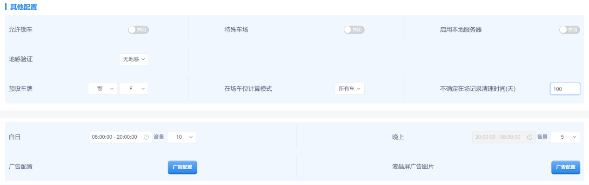

- **允许锁车**：开启后月租车可以设置开闸密码，月租车进出需要扫码填写密码开闸。若没设置密码，则自动识别出场

- **特殊车场**：针对特殊车场相机无法识别车牌设置。默认不开启

- **启用本地服务器**：服务器放在本地停车场，默认关闭。

- **地感验证**：此为辅助识别功能，默认不开。

- **预设车辆**：提高相机识别率识别速度，提前设置该城市车牌文字

- **在场车辆计算模式**：扫码车辆或总车辆

- **不确定在场记录清理时间**：不确定在场自动删除入场记录

- **音量设置**：设置白天与晚上不同时间播报音量

- **广告配置**：扫码页面展示的广告位，广告分默认广告、自定义广告，默认关闭

- **液晶屏广告图片**：闸机显示液晶屏广告配置

### 2、收费配置

- **收费类型**：二十四小时、计次收费、时间段收费、白天夜晚跨时段计费

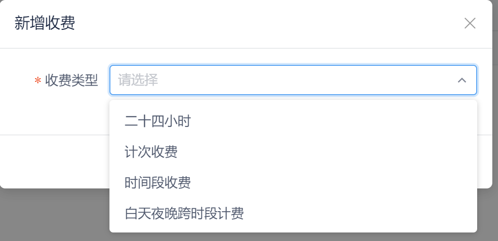

#### 二十四小时

此案例为一小时1块，封顶20元，免费时间30分钟。首停分钟设置为0，若设置为60则第一小时免费，从第二小时算起。

- **停车时间包含免费分钟**：举例说明，开启后一小时30分钟收费为2元，不开启为1元。

- **封顶收费含过夜费**：设置过夜费后，封顶里是否含过夜费用，不含则为封顶加上晚上过夜时间

- **是否启用多次进出按天封顶**：启用后，同一辆车当天进出按天封顶

- **多次进出按天封顶方式**：停车24小时（可跨天）、自然天24小时（固定晚上12点算结算点）

- **多次停车每日收费限制金额**：除封顶外，多次进出设不设置限额。

#### 计次收费

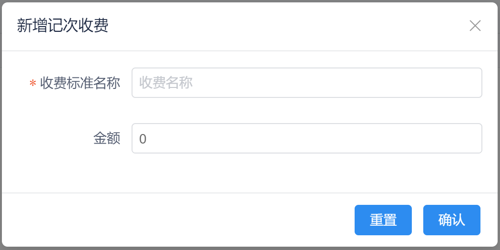

#### 时间段收费

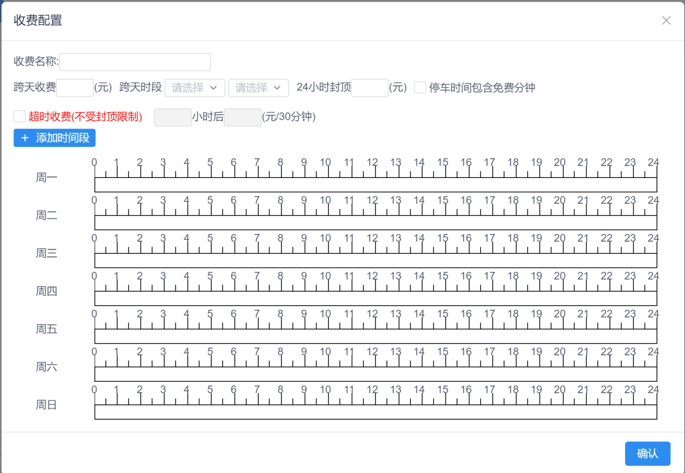

将时间按星期划分，可设置高峰与平时各异收费标准

跨天收费涉及到隔天收费标准不同，所以设置指定金额，例如过晚上24点为跨天。

- **24小时封顶**：跨段后24小时封顶收费

- **停车时间包含免费分钟**：同上

- **超时收费（不受封顶限制）**：开启后方可设置多长时间后每半小时收多少

添加时间段如下图：

注意，整个收费标准从星期一0点开始设置，一直设置到周日晚24点为止，最小单位为半小时。

#### 白天夜晚跨时段计费

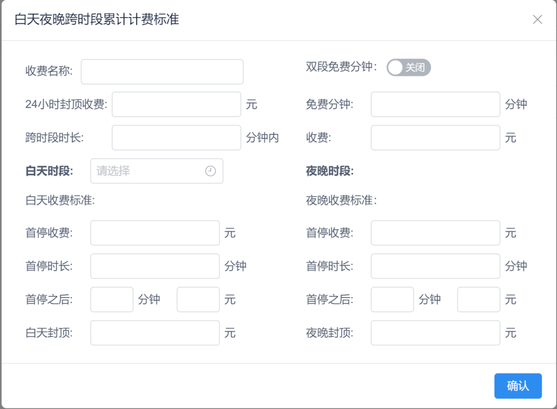

设置2个时段收费标准，类似于时间段收费标准。

#### 节假日收费标准

点击新增后填写节假日收费标准名称，填写折扣，折扣按百分制规则（例如填写90，则按照现行临时车标准打9折）

设置开启时间与结束时间后确认保存，到达设置时间自动启用。

#### 车场配置

- **初始余位**：设置显示屏余位功能

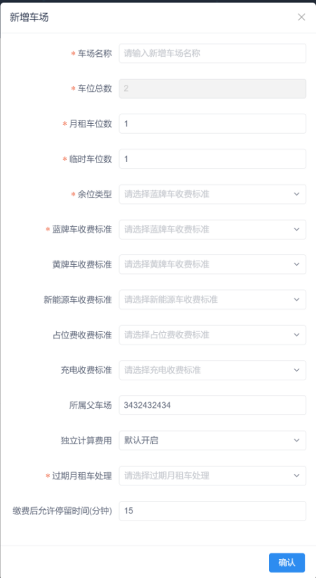

新增车场，不同车牌设置不同收费标准

- **所属父车场**：创建大小车场，输入大车场ID

- **独立计算费用**：默认开启，关闭后小车场不独立收费，统一到大车场出场收费。

过期月租车处理：

共有七种过期车辆设置模式

- **允许停留时间**：付费识别开闸后允许停留时间

#### 车道配置

- **车道类型分**：入口、出口、入口虚拟、车位相机、共用闸机

临时车通行方式：

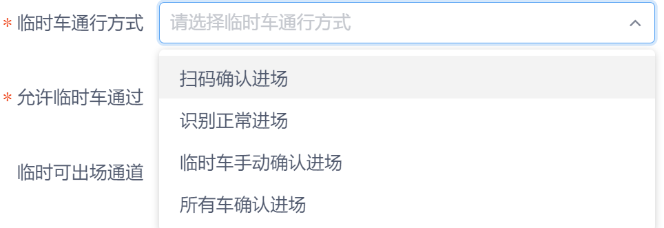

相机升级后填写相机序列号即可

- **物联卡ID**：建议去营业厅开通，不会造成网速慢问题。插卡后，与有线网实现双重保障，有线网断网后10秒开始启用物联卡，并发送通知到管理员公众号提醒。

- **相机授权**：选择启用

- **车牌通行权限**：默认全部勾选，取消勾选，对应类型车牌无法进出

- **黄牌开双闸**：根据不同车场设计，选择是否开启，默认为否

设置为出口时内容有所变动，如图

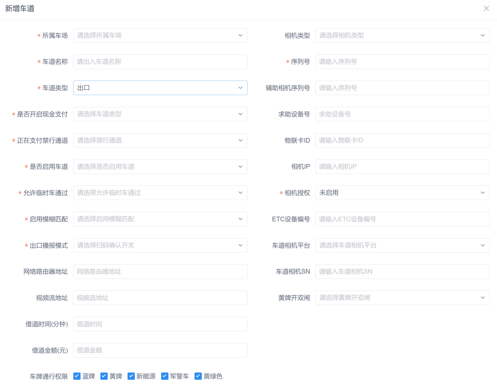

- **是否开启现金支付**：配套岗亭端使用，可收现金

- **正在支付禁行通道**：使用场景同进同出，绑定后出口正在支付，入口来车会语音播报提示退后等待出口支付完成再入场。

- **设置借道时间、借道金额**：在免费时间内生效，用于临时入场车辆且停留时间较短

车道配置好后设置滚动字幕，点击控制卡配置。

- **车牌识别方式**：虚拟线圈与虚拟线圈加地感触发二选一，第二种情况有施工要求。

- **控制卡类型**：控制卡对接了科发，DT，FK TTS语音版。

- **动态二维码**：显示屏可开启动态二维码，在二三四行显示

- **延时关闸**：开闸后无关闸信号可设置时间关闸

- **有线网检测地址**：填写当地宽带营业厅检测地址，例如电信填写114.114.114，作为断网公众号通知提醒功能。

点击首行内容，可填写显示屏第一、二、三行内容，自定义文字

关闸功能需要相机关闸信号也接到道闸

- **获取地感状态**：用于判断闸机不落闸原因

- **控制信号**：端子、遥控器用于手动控制道闸开关。

#### 相机配置

创建车道后，生成对应的相机配置，如下图

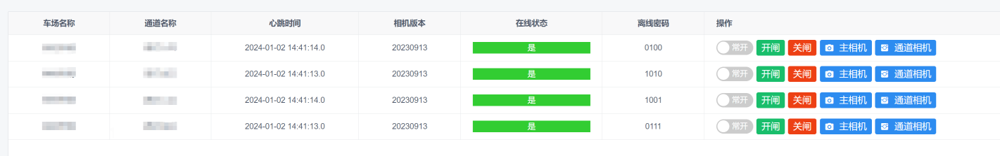

相机状态绿色代表相机在线，红色代表掉线，点击主相机，进入相机网页端调试界面；点击通道相机，直接远程通道相机，跳转车道监控实时视频画面。

#### 车位管理

通过添加车位相机，检测停车位上有无车辆以及车辆的车牌信息。

【新增】添加车位相机，选择所属车场、输入相机名称、相机SN，选择停留权限车牌，可设置左右车位的收费标准，确认提交。

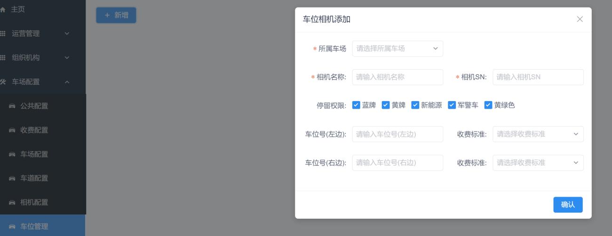

添加成功后，查看停车位占用情况，可操作修改、删除。

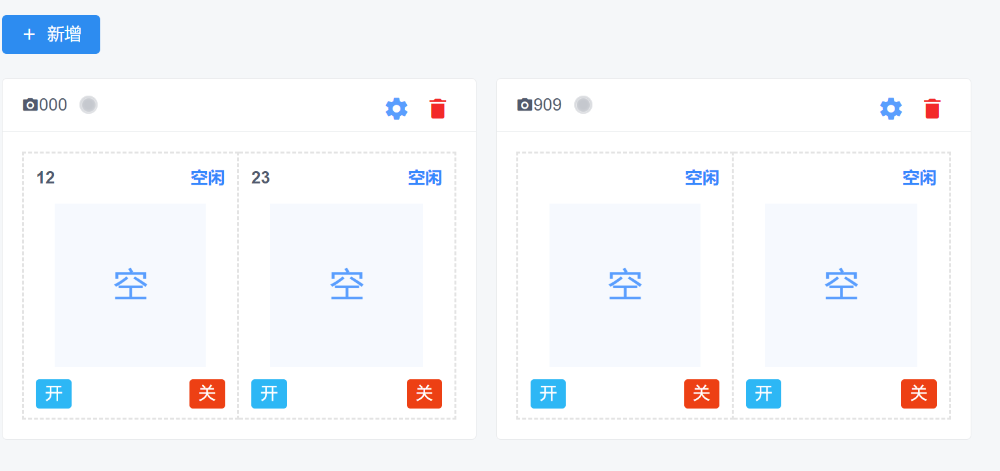

#### 开闸日志

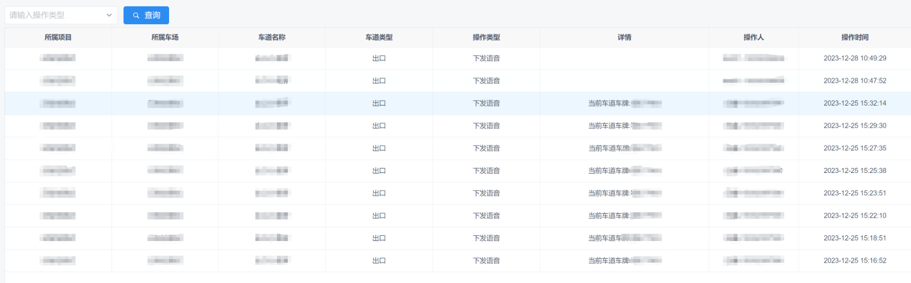

对操作类型可进行筛选，所有通过系统开闸的操作（包含手机端），平台全部有记录，车道有车辆时，详情内容有车牌信息。

#### 二维码

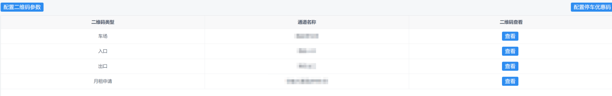

创建车道后生成对应二维码，预支付码、入口码、出口码、月租申请码

二维码查看弹窗，点击生成图片并下载，直接下载到本地。

- **预付折扣码**：右上角点击【配置停车优惠码】，选择车场、收费标准，点击确认，生成预付折扣码二维码，下载使用。

#### 自定义语音

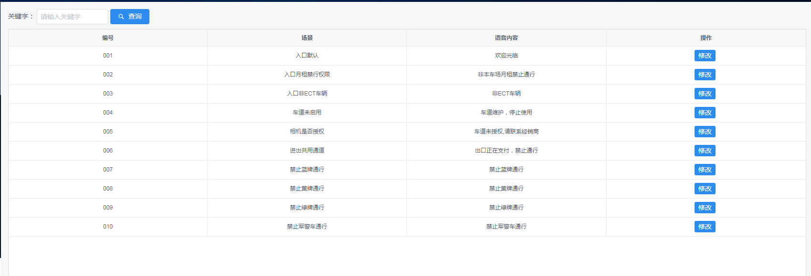

点击修改可自行填写播报内容

## 六、预付退款

### 1、无牌退款

无牌车手动申请退款列表

#### 退款记录

### 3、保证金退款

无入场记录保证金退款内容，不开启自动退款数据会累积在车场内，金额会到提现账户内。

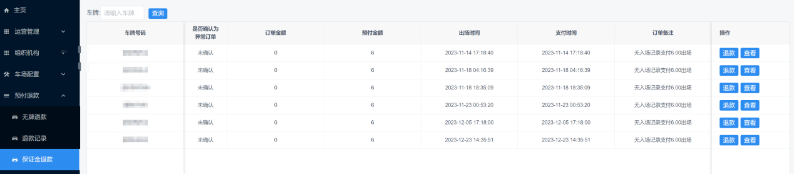

## 七、车场业务

### 1、月租套餐

#### （1）套餐类型：月租、储值、时段月租套餐

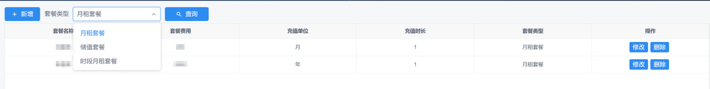

常见为月租套餐，充值单位有日、月、年

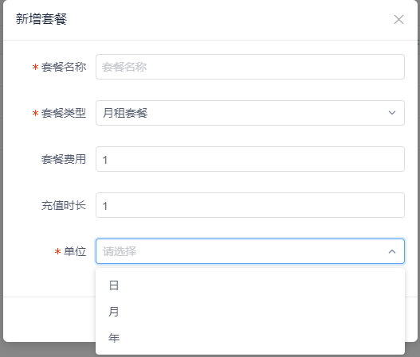

储值套餐为储值卡模式，常见为商场充100得110类型。每次抵扣当前临停费

时段月租定义为在一天的某个指定时间段内为月租车，其它时间执行临时车收费标准

#### 黑名单

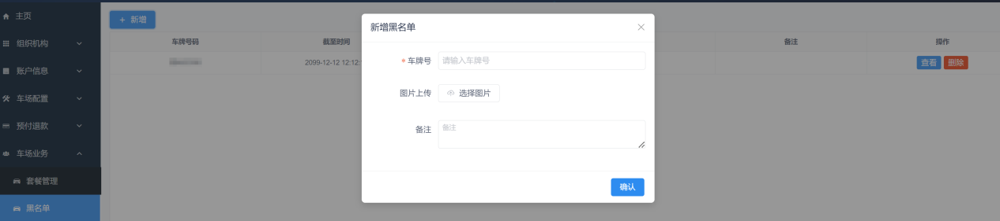

【新增】可输入黑名单车牌或者车主电话号码，上传车辆照片。

列入黑名单车辆，在入场时，闸机显示屏会给出提示，让车场管理员确认是否放行该车辆。

#### 车主车辆

#### 车主管理

【新增车主】输入用户名、选择所属部门，车位数量默认1，超位车位正常入场、一位多车默认开启，其它信息选填。

【批量删除】批量删除当前页面被勾选的车主信息

【批量导入车辆】下载车辆导入模板，填写excel表格必填项。

【月租车导出】导出对应项目的所有部门下所有车辆信息。

操作栏【新增车辆】一个车主下可以添加多辆车；

【充值】对用户账户进行充值；【修改】修改车主信息；

【删除】删除对应车主及车辆信息。

有车主存在多辆车，多个车位的情况，**车牌显示为辆数，点击可查看车牌详情**

#### 车辆管理

【新增车辆】新增车辆，选择套餐、对应所属车辆、收费标准，可设置禁行车道；

【批量删除】当前页面被勾选的车辆，可操作批量删除；

【批量修改】同一类型车辆，可操作所属车场、过期收费标准、禁行车道的批量修改

列表操作栏【微信绑定】车主可以绑定微信，扫码进出；

【月租延期】月租车操作延期，分套餐和自定义延期

【修改】、【删除】单个车辆进行的操作。

- 时段月租

时段月租定义为在一天的某个指定时间段内为月租车，其它时间执行临时车收费标准

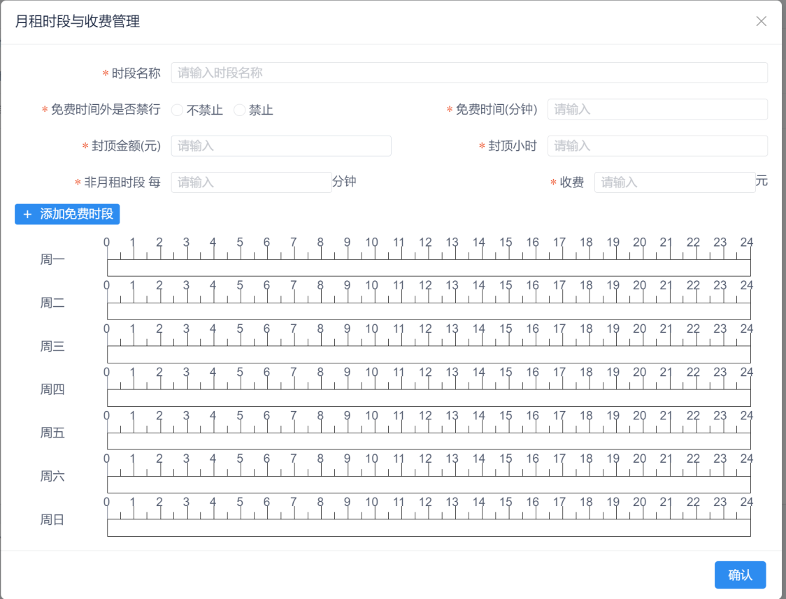

添加的时段是月租时段，非月租时段按标准收费，还可设置非月租时段是否禁行

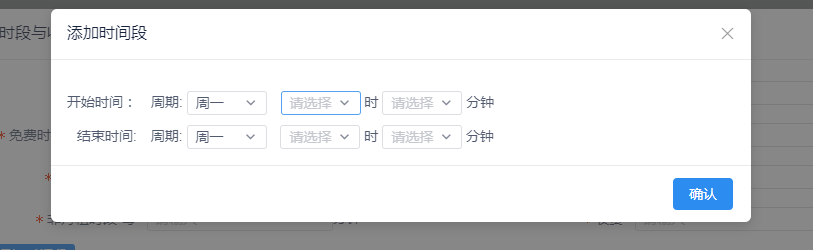

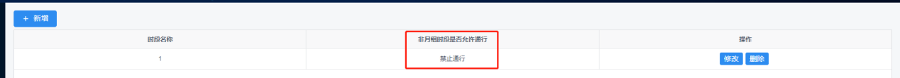

设置完后，新增时段限制月租选择收费标准即可。

## 八、优惠券

### 1、商户管理

添加商户

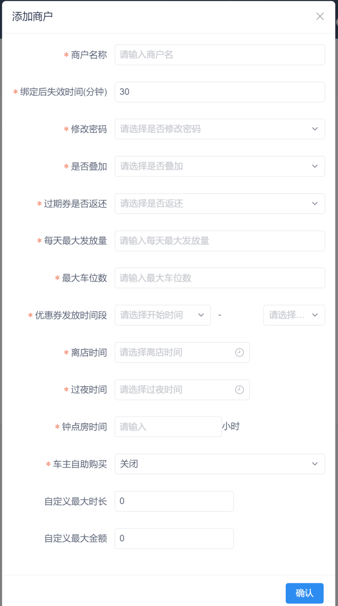

- **绑定后失效时间**：指定车牌发券、公众号动态券的有效时间

- **是否叠加**：同一类型的优惠券可选择是否叠加使用，例如小时券，金额券

- **过期是否返还**：券设置的有效期内未使用，是否返还到券库存

- **每天最大发放量**：例如金额券，避免浪费

- **最大车位数**：各个商户最大车位是多少

- **优惠券发放时间段**：针对各类商户使用时间设置

酒店有住店车，钟点房情况，设置离店过夜以及钟点房时间

- **车主自助购买**：开启状态则需要车主自行扫码购买优惠券，默认关闭

- **自定义最大时长、金额**：指定发券的时长券、金额券单次发放的最大数量限制

查看更多，发放批次券，最大发放量不超过600张

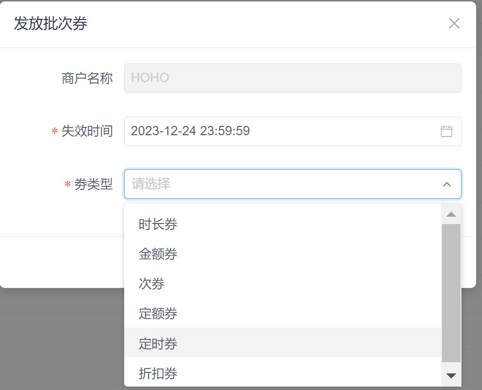

发放成功后，点击【打印】，查看打印优惠券效果如下图：

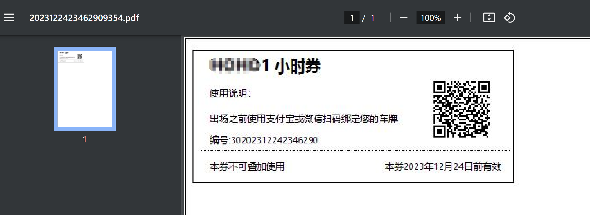

发放宴会券，同批次券一样，最大发放数量不超过600张

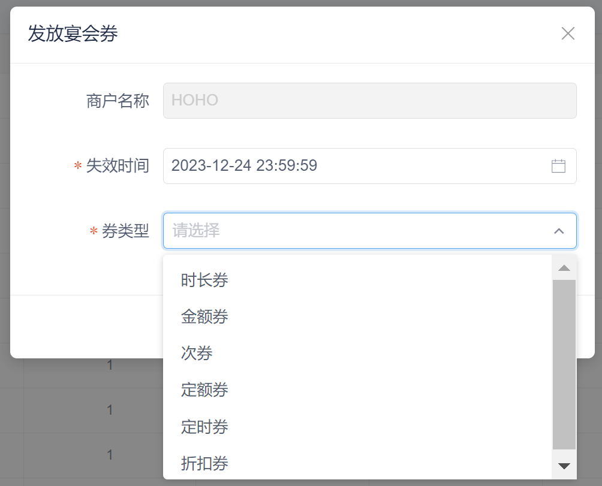

发放成功后，查看打印效果如下图：

新增住店车，开房类型分住店车、钟点房

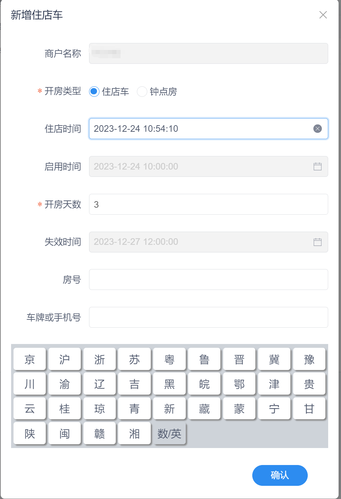

新增住店车后，可操作续房、退房、修改车牌。可自行下载住店车二维码，如下图：

#### 套餐管理

#### （1）时长券（按时间优惠）

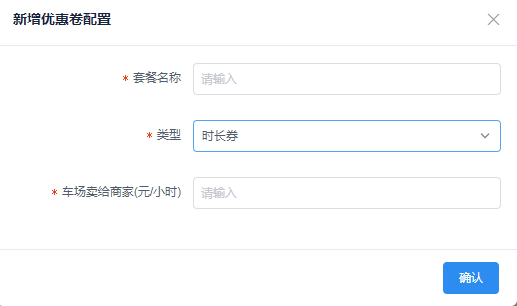

#### （2）金额券（打折券）

#### （3）次券（按次免费）

#### （4）住店券（旅店消费，车位免费停车）

（5）定额券、定时券、折扣券（按张抵扣设置金额、小时、折扣）

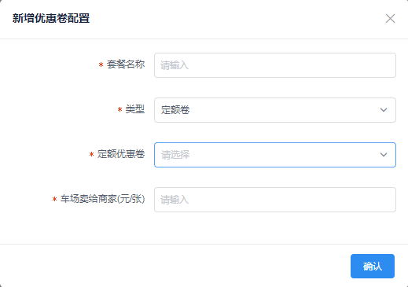

#### 定额券

可操作【新增】、【删除】，新增-设置固定面值金额

#### 定时券管理

定时券为定制一张券优惠几个小时

#### 折扣券

折扣券为一张券直接给当前停车费打几折

#### 优惠券统计

汇总所有优惠券的发放、使用、优惠金额、过期时间、发放类型、券状态等。筛选时间范围可导出列表数据

#### 优惠券日/月统计

按日、月统计优惠券发放、使用、返还、优惠金额、券库存等情况

### 8、三方优惠券

对接第三方平台，列表展示充电车辆信息，可配置充电优惠

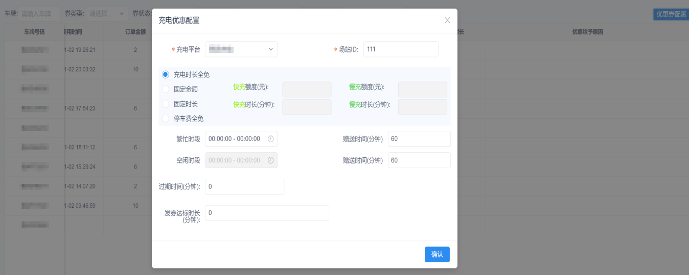

## 九、数据分析

### 1、在场车辆

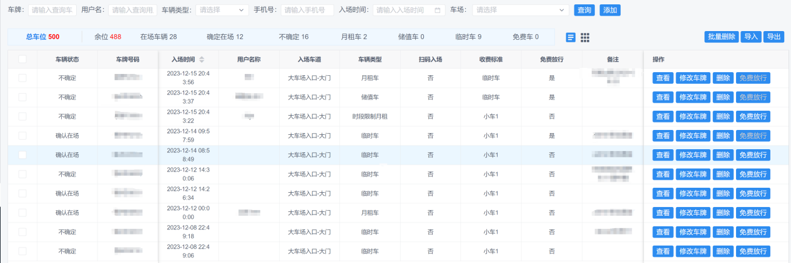

可查询在场车辆，车牌，用户名，车辆类型，入场时间，筛选同一项目不同车场。

【添加】手动添加车辆入场，可选择车场、收费标准、入场时间。

【修改】、【删除】对当前车辆信息进行的操作

【免费放行】对入场车辆操作免费放行。

#### 进出记录

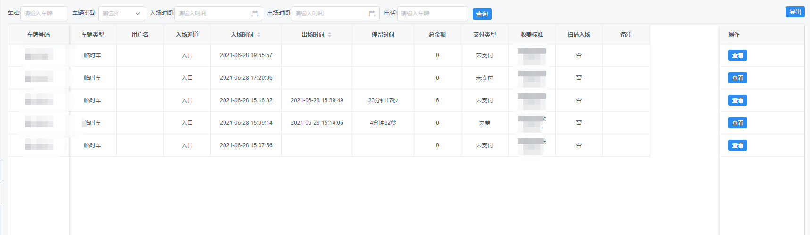

此处重要信息为支付类型，查看比对未支付情况，最后的备注功能为异常进出信息。

#### 支付记录

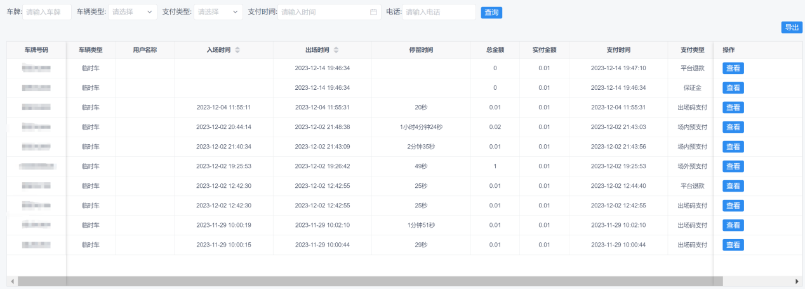

此处重点查看车辆支付金额、支付类型等

#### 月租充值

记录月租车增删查改、后台充值等情况

#### 异常记录

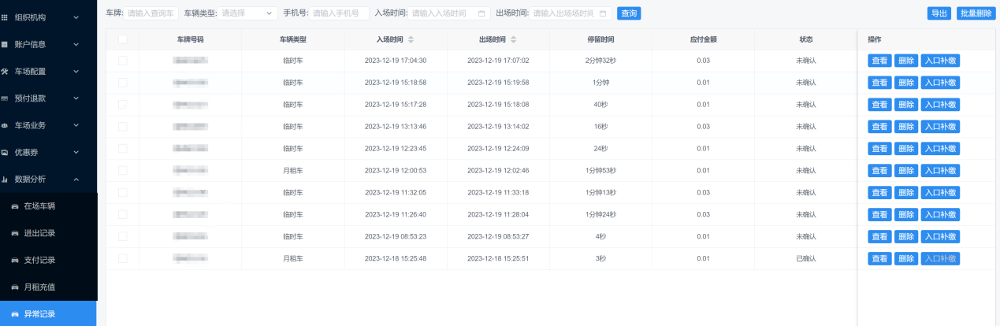

该记录为出场未缴费订单，点击入口补缴，车主下次入场则需扫码缴清上次欠款才可入场。如有异议，可调取数据照片查看。注意：必须要点击入口补缴才可以进行补缴，不下发还是当临时车处理。若开启自动补缴功能，则每天晚上0点自动下发

#### 数据统计

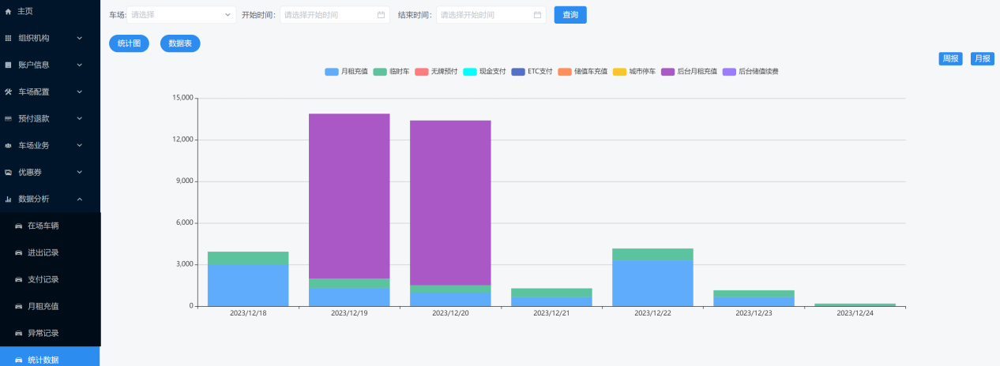

可切换数据表和柱状图，还可分为周报，月报。

鼠标放在柱状图上后会显示金额明细，如图，最后的结算金额为实时到账扣除提现手续费的费用。

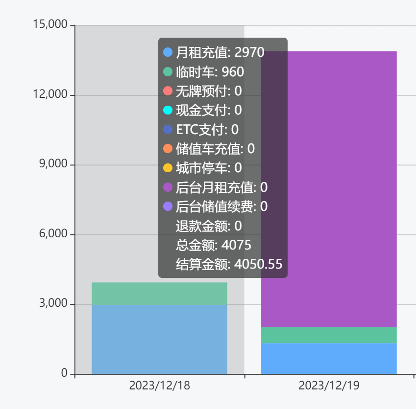

#### 滞留车辆

此功能为不占总车位余位设计，需要人工排查是否在场。可导出列表所有滞留车辆数据

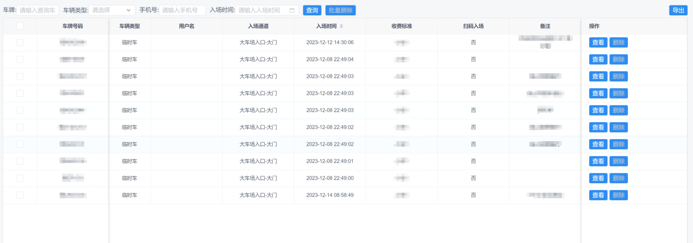

#### 现金支付记录

岗亭端功能，点击查看，可查看车辆进出记录

#### 短信使用记录

列表显示记录手机号、发送时间

#### 短信充值记录

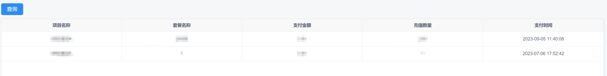

## 十、预约车辆

### 1、预约单位

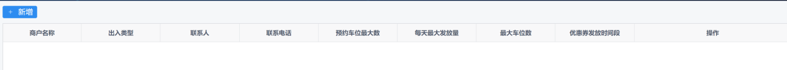

此功能针对商户使用，预约对象为商户，商户可自行登录账号填写预约车辆

### 2、预约车辆

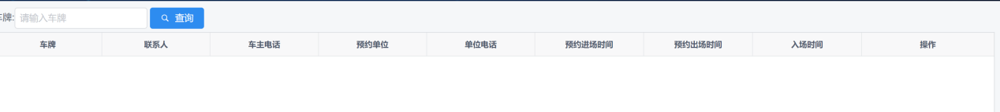

查询预约车辆相关信息。
