停车Boss无人值守停车管理系统 — 预约车辆说明书

本说明书介绍预约单位的创建与管理，以及车主预约进场、审核查询的完整流程。

## 一、预约单位创建及功能说明

系统管理员可在后台对预约单位执行添加、修改、删除等操作，以保证信息的精确与及时。新增预约单位时，必须输入单位名称、联系人、联系电话、地址等基础信息。

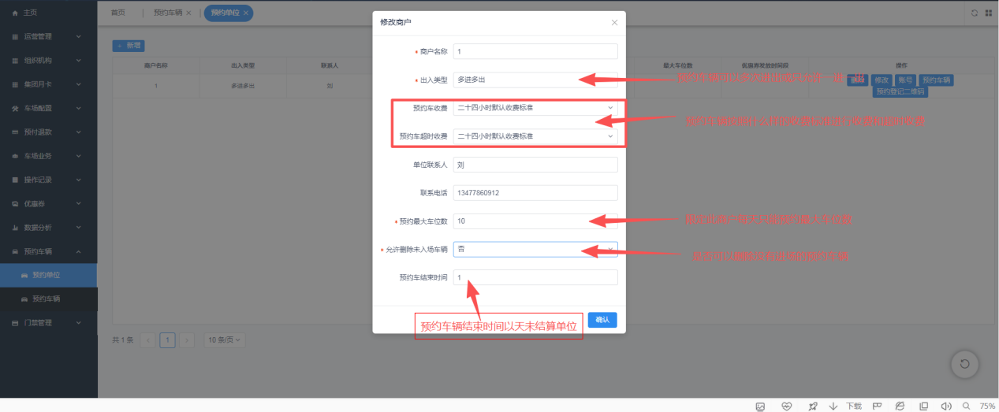

每个预约单位可创建一个或多个登录账号，便于单位自行管理本单位预约车辆。单位管理员使用账号登录系统，进行本单位预约车辆的新增、审核与查询。

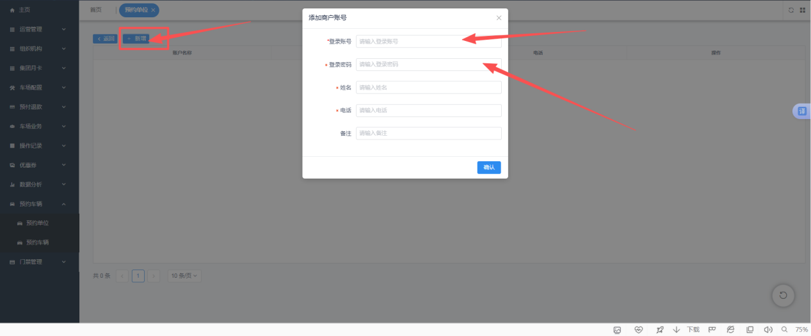

预约单位及账号创建成功后，点击【预约登记二维码】，系统会生成一个二维码，供车主扫码登记个人信息进入车场。

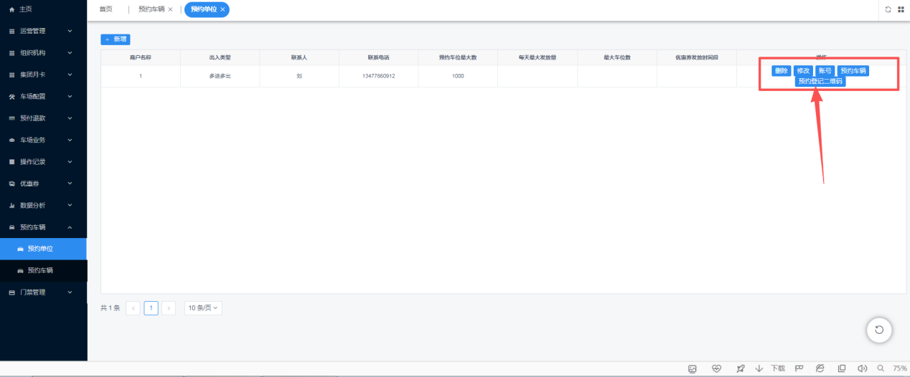

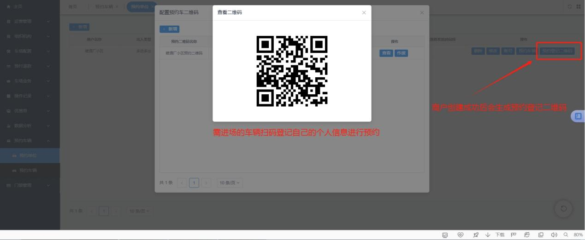

## 二、车主如何预约进场

**方式一：扫码预约**

车主在入口扫车场提供的预约车辆二维码进行预约申请：点击“办理预约车辆” → 填写个人信息 → 等待审核 → 审核通过方可进入场内。

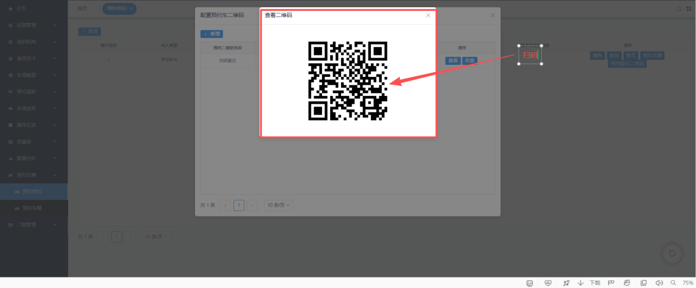

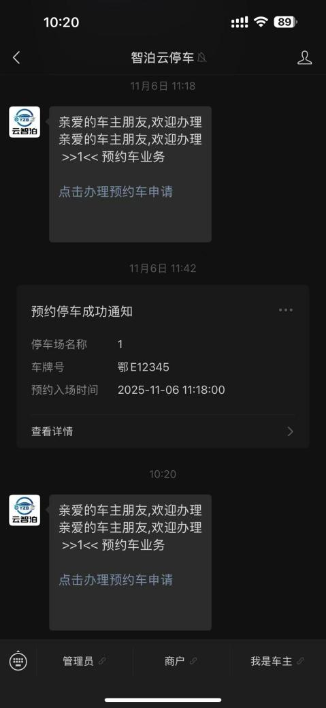

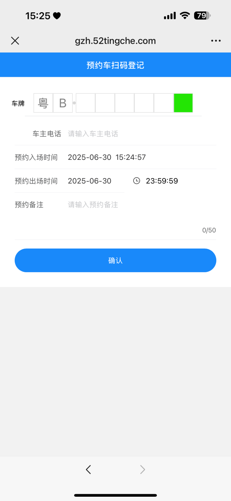

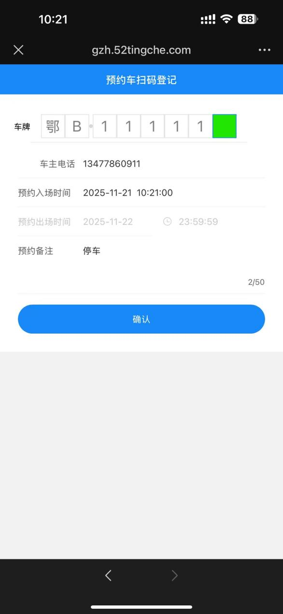

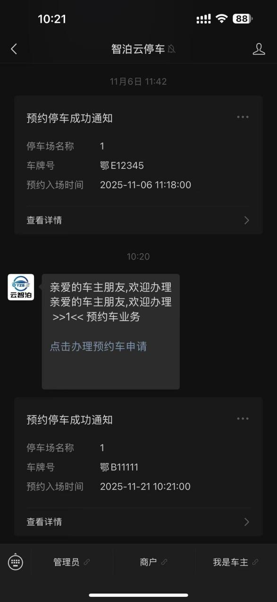

**方式二：手动添加**

手动添加预约车辆信息（车牌号码、电话号码、需入场的时间），点击确认后查询该车辆结果。手动添加的车辆会自动审核，无需再次审核通过。

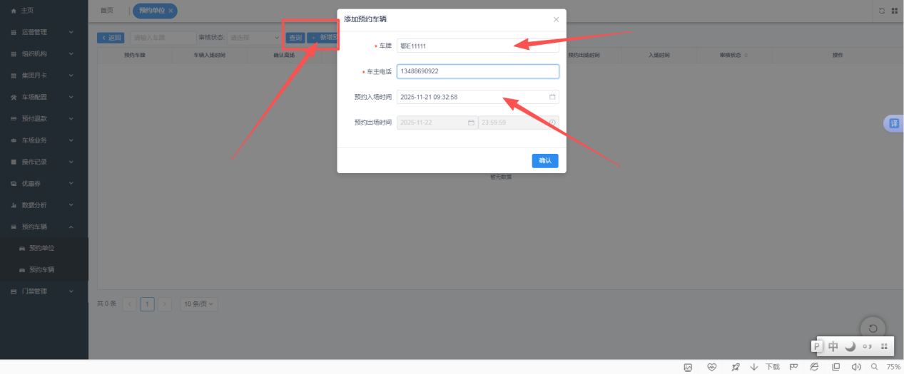

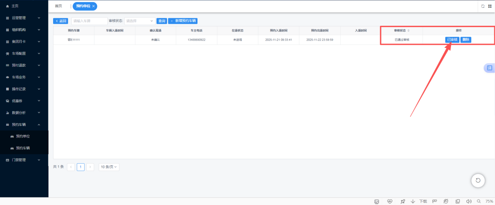

## 三、预约车辆查询及电脑/手机审核流程

“预约车辆”中会详细记录预约进场时间与出场时间，生成完整的停车记录，并可查询车主电话与预约时间。此处展示手动添加与车主自主申请预约进场的记录，预约单位可在此审核车主的预约请求。

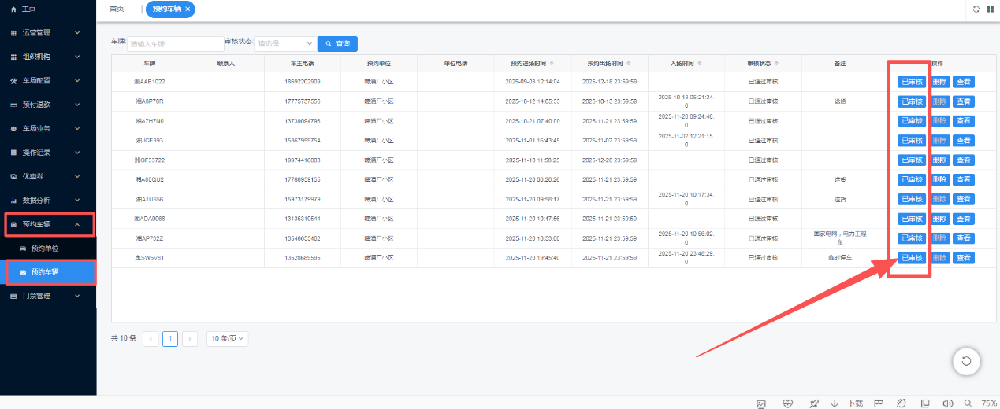

手机关注停车Boss公众号，点击【商户登录】后可在手机端审核预约车辆。登录后，后续有预约车辆时会收到提醒；如拒绝申请，则车辆不能入场。

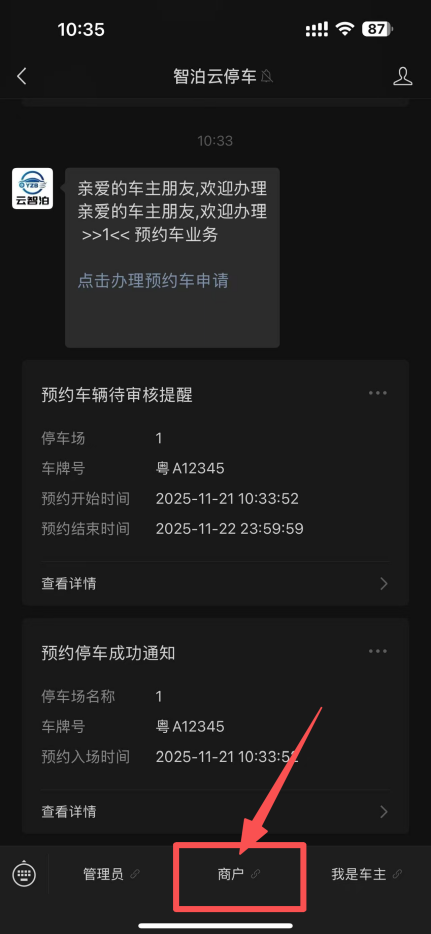

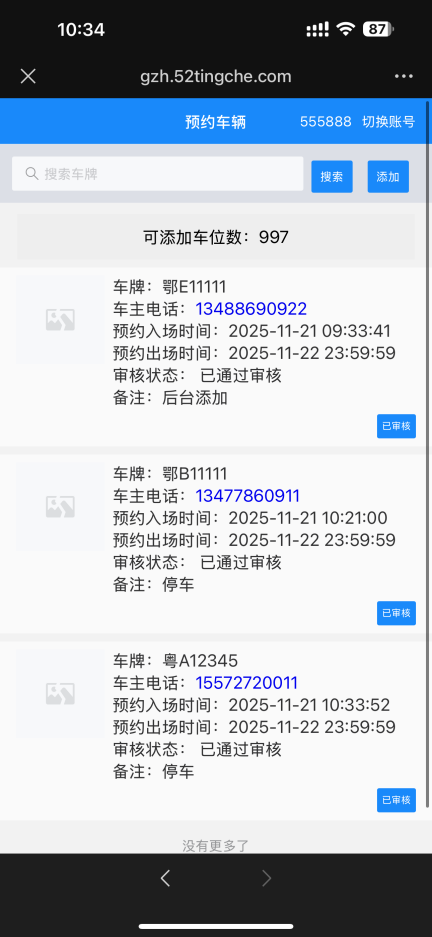

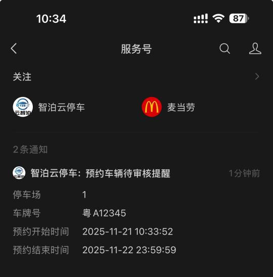

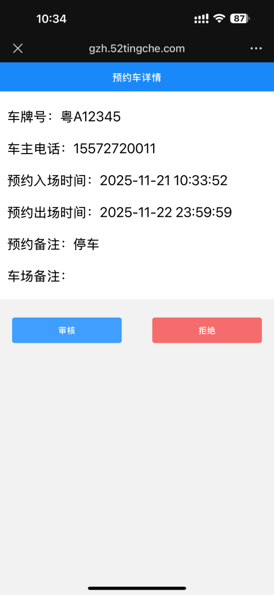

