云平台车主车辆板块操作指引

本指引介绍车辆管理的前置配置（套餐、车辆类型、部门）、车主与车辆管理、月租导入等操作方法。

## 一、进入车辆管理

车辆相关信息进入“车场业务”板块。

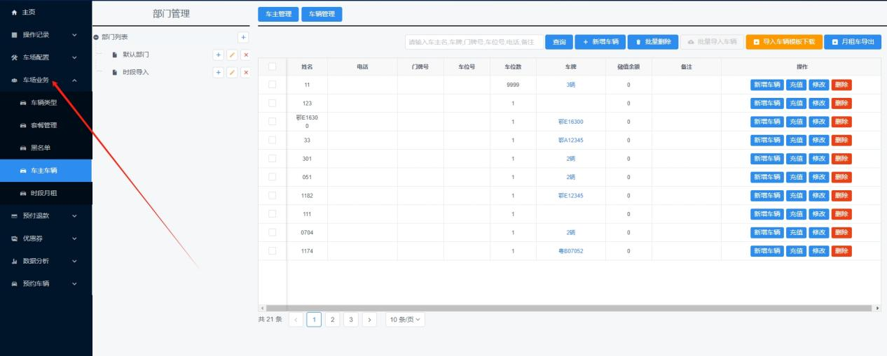

## 二、添加车辆前的套餐与车辆类型配置

添加车辆之前，需要先设置相对的套餐管理与车辆类型配置。

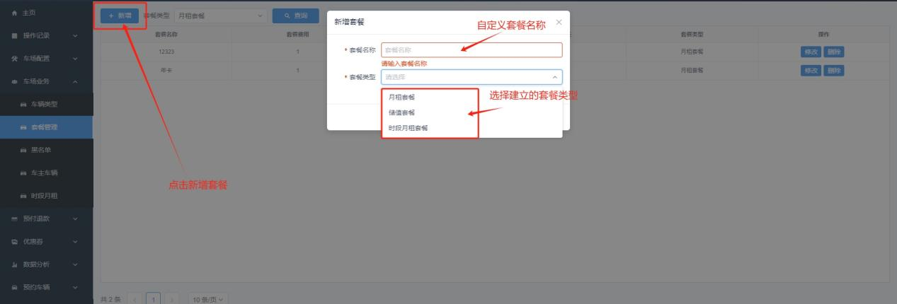

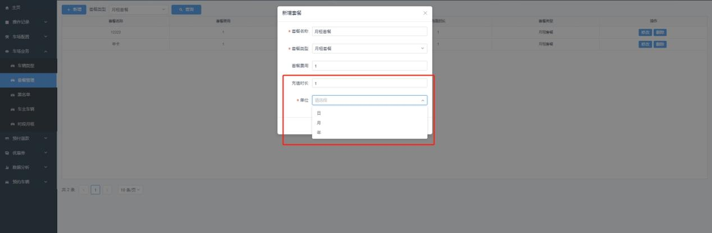

1. 充值时长和单位为绑定属性，例如设置套餐费用 300、充值时长 1、单位月，表示该月租套餐为 300 元/月。
2. **月租套餐**：对应月租车的套餐。
3. **储值套餐**：对应储值车的套餐。
4. **时段月租套餐**：对应时段月租的套餐。
5. 此页面默认显示月租套餐；若需查询储值车套餐或时段月租套餐，选定套餐类型后点击查询。

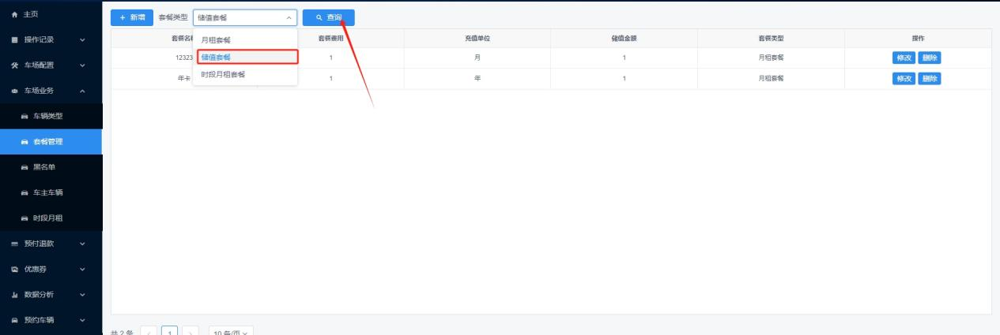

> **注意：** 第一步先建套餐，因为后续车辆类型、录车都需选定套餐。套餐用于匹配对应的车辆类型及包月/包年资费，同时车主线上月租续费也会按此处设置的价格计费，请按实际收费谨慎填写。

## 三、新建和修改车辆类型

车辆类型是在录入车辆的必选项，系统自带 5 类：月租车、免费车、时段月租车、临时车、储值车。

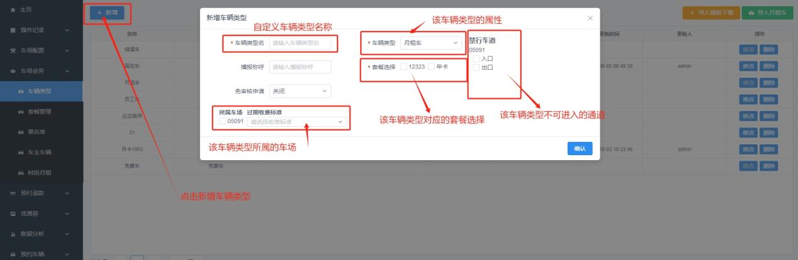

1. **月租车**：有效期内自由进出，需绑定套餐；过期后车主可扫码线上支付延期（车场开启线上续费），也可后台延期（套餐延期或自定义延期）。
2. **免费车**：有效期内自由进出，无套餐；到期由后台修改时间，不可线上续费。
3. **时段月租**：属性类同月租，区别为指定时段内为月租，非时段内为临时车并产生费用。
4. **临时车**：录入的临时车可配置绑定收费标准，多用于低于一般收费标准的车辆，有效期默认为 2099-12-31。
5. **储值车**：功能类似临时车，绑定收费标准计费，多储值功能、需绑定套餐；余额不足时需扫码缴费或按套餐储值，余额充足时出场先扣余额，有效期默认为 2099-12-31。
6. 车辆类型可自定义名称，选择一个车辆属性后配置对应套餐及所属车场，录车时按情况选择预设车辆类型即可。

## 四、部门管理

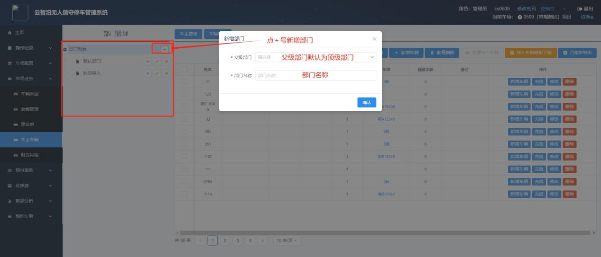

1. 部门可以新增也可以不新增；不新增部门时，所有车辆录入在默认部门。
2. 部门的用途：根据名称区分相同属性车辆的整理汇总。
3. 父级部门默认为顶级部门，可在新增部门下新建子部门，按实际需求设定。

## 五、车主管理

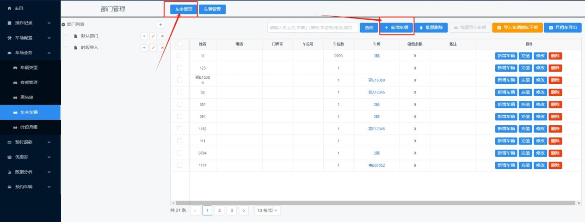

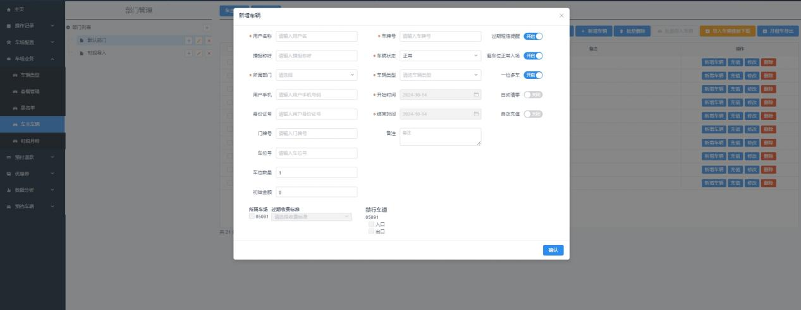

1. **批量删除**：选择多个车主，点击批量删除一起删掉。
2. **月租车导出**：导出系统内录入的所有车辆。
3. **车主后新增车辆**：同车主名下录入多辆车。
4. **车主后充值**：储值车充值。

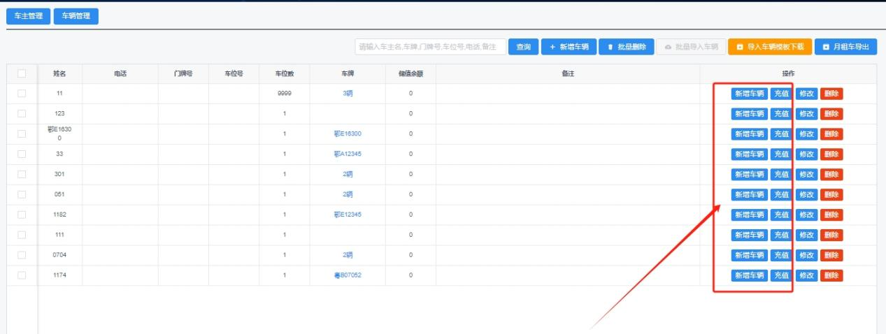

5. **过期短信提醒**：月租车过期后，向车主绑定手机号发送过期信息。
6. **超车位正常入场**：开启时超位入场允许超位车辆入场，关闭则不允许。
7. **一位多车**：
   - （1）同主车名下录入月租车数量 ≥ 2 时，形成一位多车。
   - （2）开启前提必须是车名下均为月租车。
   - （3）开启时，先入场的为月租，后入场的为临时车。
   - （4）本质是多辆车共用一张月卡；若非公用月卡，则关闭一车多车或将车主名称分开录入。
   - （5）开启时新录入车辆自动同步到期时间，且新录入车到期时间不可修改。
   - （6）若车主名下已有车在场，后入场车记录超位入场，超位通行的权限与计费标准根据设置决定。

## 六、车辆管理

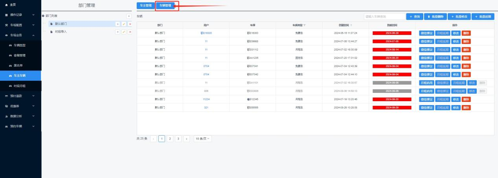

1. **批量删除**：同时选择多辆同属性车一起删除。
2. **批量修改**：同时选择多辆同属性车一起修改。
3. **批量延期**：同时选择多辆同属性车一起延期。
4. **微信绑定**：车主扫码绑定微信，用于无牌月租、无牌车办理月租时进出场微信扫码。
5. **月租报停**：有效期内月租车可点击报停，报停后属性变临时车、按临时车计费；点击月租启用后恢复月租属性，并补齐报停至启用期间的时长。
6. **月租延期**：可选套餐延期和自定义延期；套餐延期按预设套餐时长及金额延期并记录后台月租充值金额，自定义延期自选时长和金额，同样在数据统计内显示。

## 七、月租相关的充值、删除记录查询

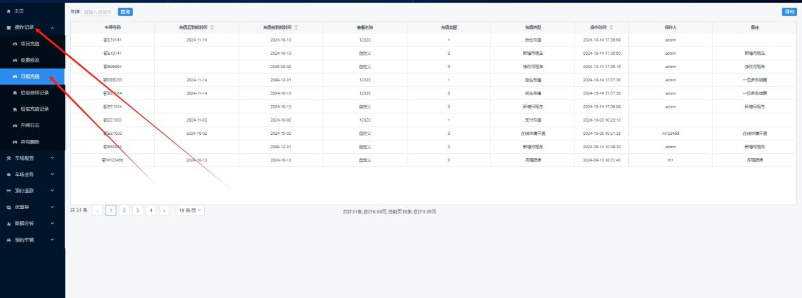

## 八、月租车导入

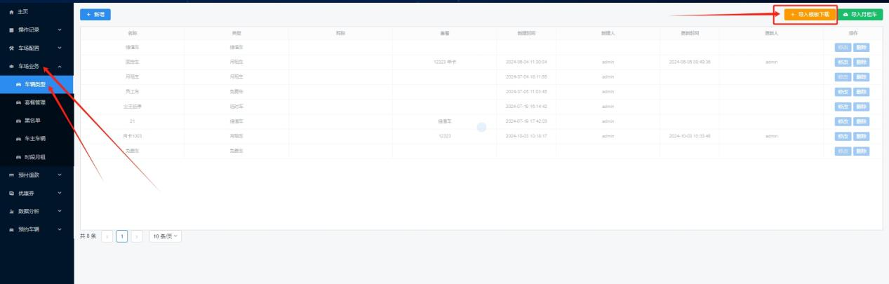

1. **下载导入模板**。

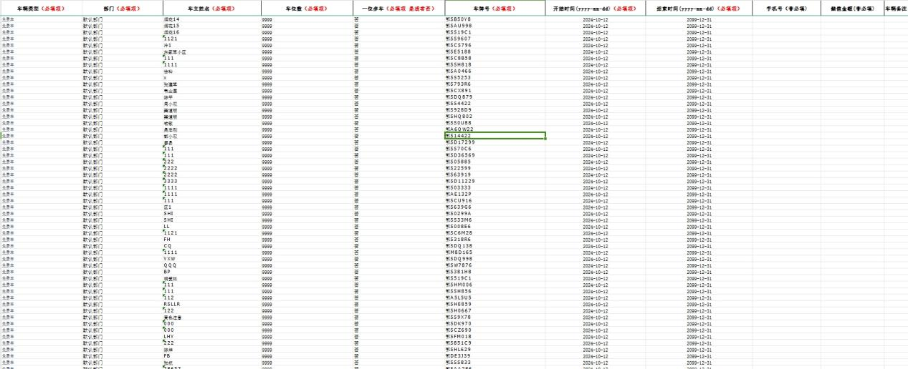

2. 根据表内提示格式填写导入数据，标记必填的信息不能缺失。
3. 手机号可以不填；若填写，后台有校验，非手机号码会报错。
4. 车辆类型：对应车辆类型里面的名称。
5. 部门：对应车辆管理的名称。
6. 车位数：
   - （1）一位多车：导入时选择“否”。
   - （2）开始时间和结束时间：平台格式要求 `yyyy-mm-dd`；若有多余信息（如 `2024-10-15 23:00:00`）需删除后面的时间，否则导入报错。
7. 车牌里没有字母 `i`（I）和 `o`（O）；若导入表内有这两字母，替换为 `1` 和 `0`，否则提示车牌错误。
