停车Boss微信小程序使用说明

本说明书介绍停车Boss微信小程序的登录、车场配置、车场数据查询与“我的”四大模块的操作方法，适用于运营端与车主端。

## 一、小程序

- 扫二维码或在小程序搜索【停车Boss】进入小程序。

- 进入登录界面，输入账号、密码，点击【登录】。

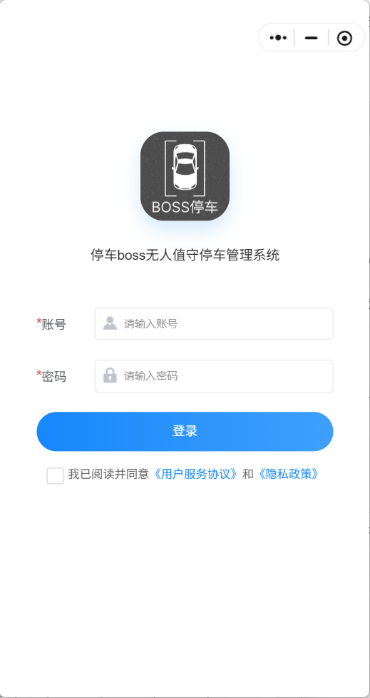

- 统计：查看车场设备、今日车次、今日收费、车场排名情况。

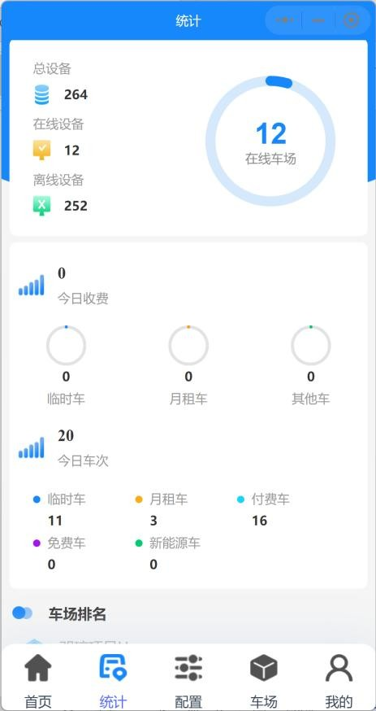

## 二、配置

### 1. 组织机构

- 查看组织机构，对城市、集团、分公司、项目进行新增、编辑、删除操作。

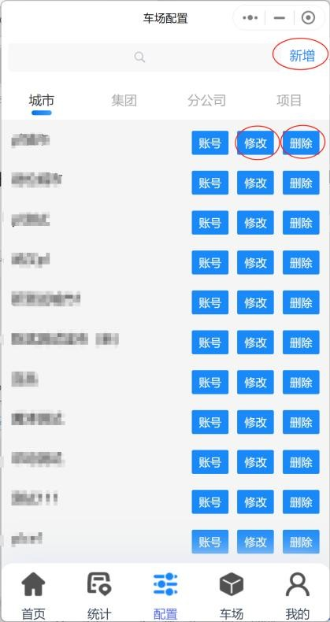

- 新增角色，配置权限，添加账号。

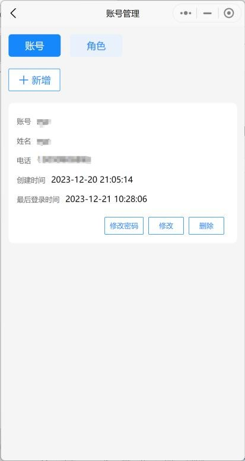

### 2. 车场配置

从项目列表点击【配置】，进入对应车场配置、商户管理、优惠券的界面。

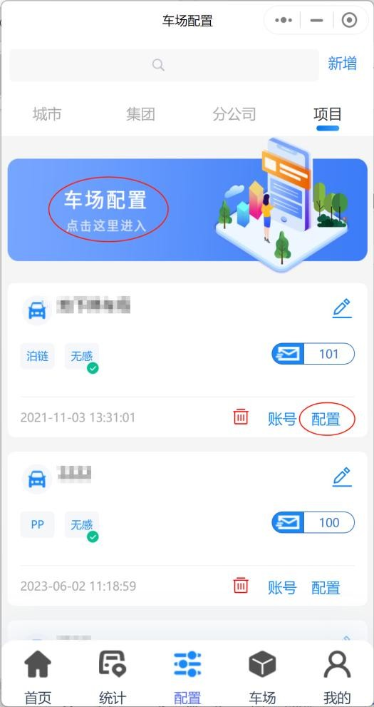

### 3. 收费配置

- 新增收费标准，收费类型有二十四小时、计次收费、时间段收费、白天夜晚跨时段计费。

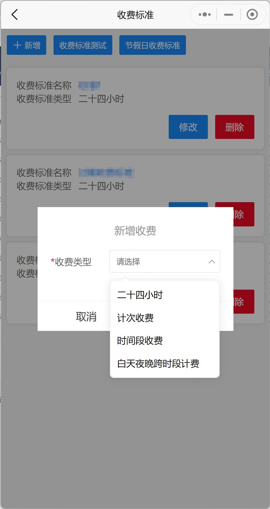

- 二十四小时收费，点击图标展开收费金额、小时，可进行设置。

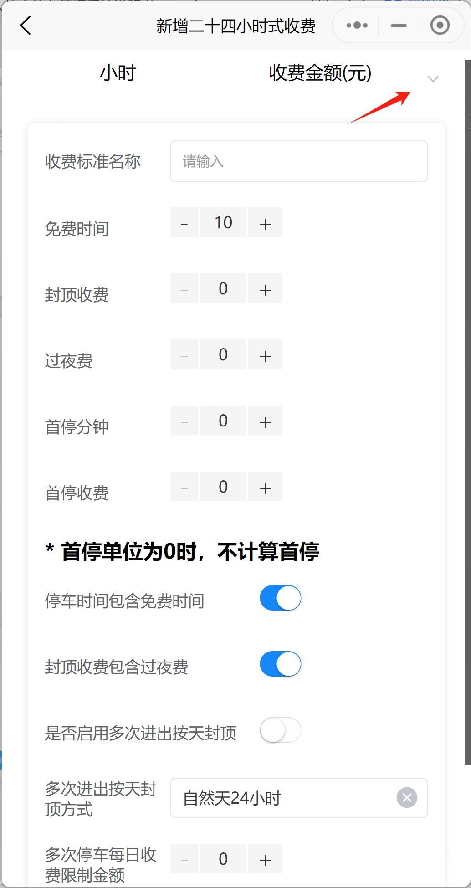

① 收费说明：如一小时 1 块，封顶 20 元，免费时间 30 分钟。首停分钟设置为 0；若设置为 60 则第一小时免费，从第二小时算起。
② 停车时间包含免费分钟：开启后一小时 30 分钟收费 2 元，不开启为 1 元。
③ 封顶收费含过夜费：设置过夜费后，封顶里是否含过夜费用；不含则为封顶加上晚上过夜时间。
④ 是否启用多次进出按天封顶：启用后，同一辆车当天进出按天封顶。
⑤ 多次进出按天封顶方式：停车 24 小时、自然天 24 小时。
⑥ 多次停车每日收费限制金额：除封顶外，多次进出是否设置限额。

- 计次收费：输入收费标准名称，设置金额即可。

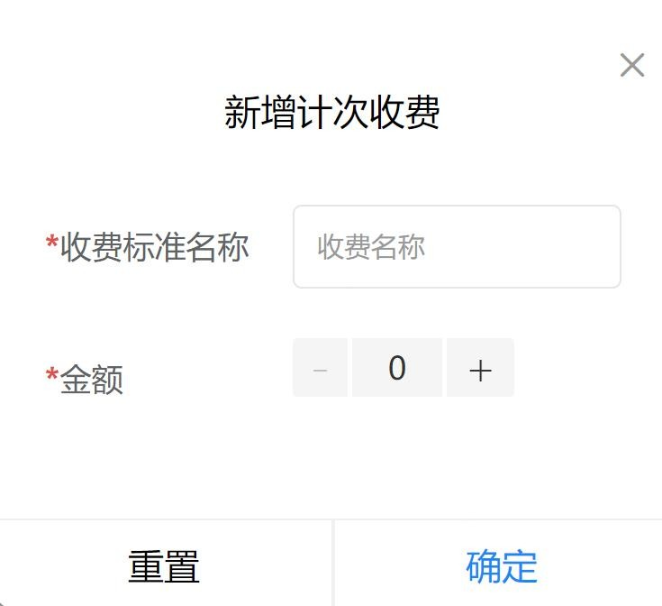

- 时间段收费：

① 将时间按星期划分，可设置高峰与平时各异收费标准。
② 跨天收费涉及隔天收费标准不同，所以设置指定金额，例如过晚上 24 点为跨天。
③ 超时收费（不受封顶限制）：开启后方可设置多长时间后每半小时收多少。
④ 注意：整个收费标准从星期一 0 点设置到周日晚 24 点，最小单位为半小时。

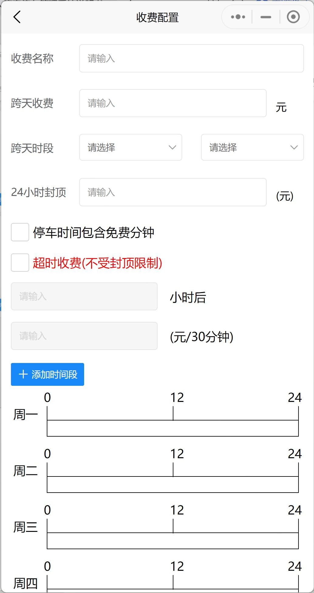

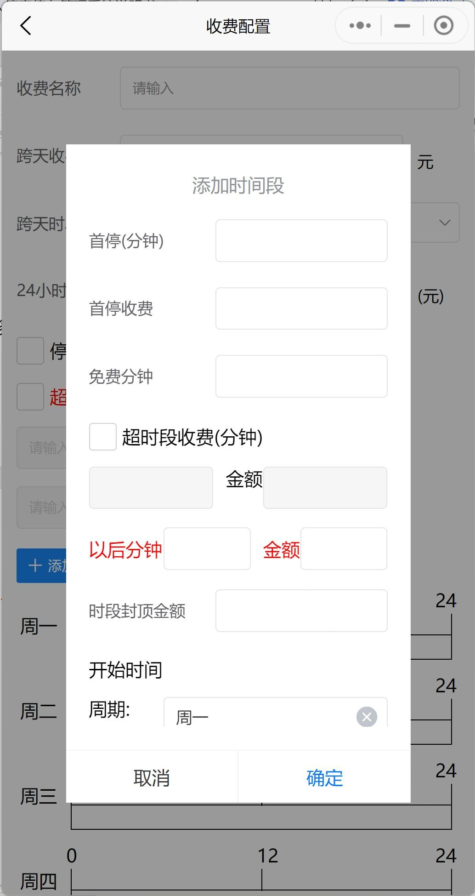

- 白天夜晚跨时段计费：设置 2 个时段收费标准，类似于时间段收费标准。

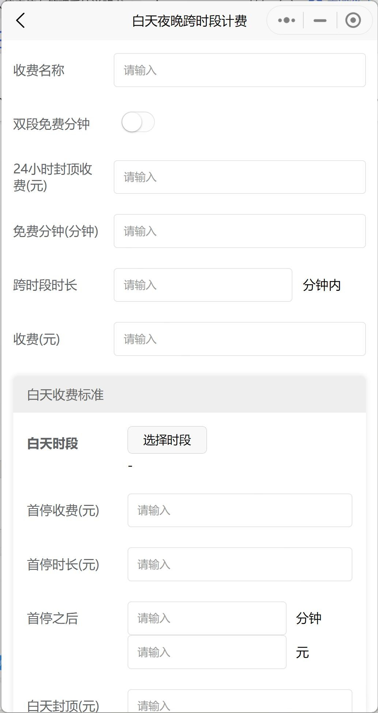

- 节假日收费标准：

① 点击新增后填写节假日收费标准名称，填写折扣（百分制，例如填写 90 则按现行临时车标准打 9 折）。
② 设置开启时间与结束时间后确认保存，到达设置时间自动启用。

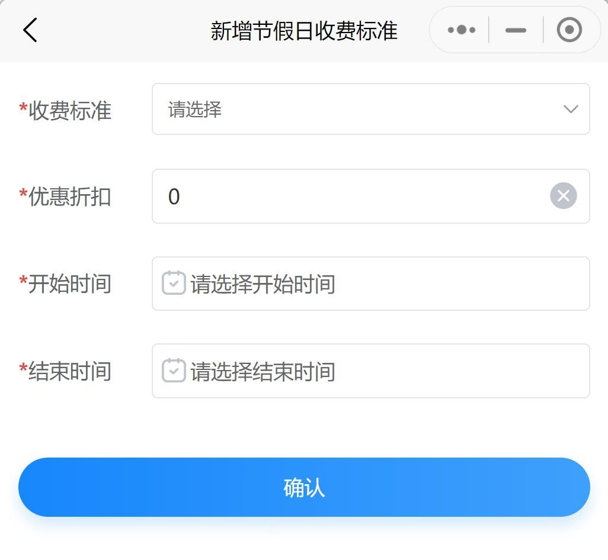

### 4. 车场配置

- 初始余位：设置显示屏余位功能。

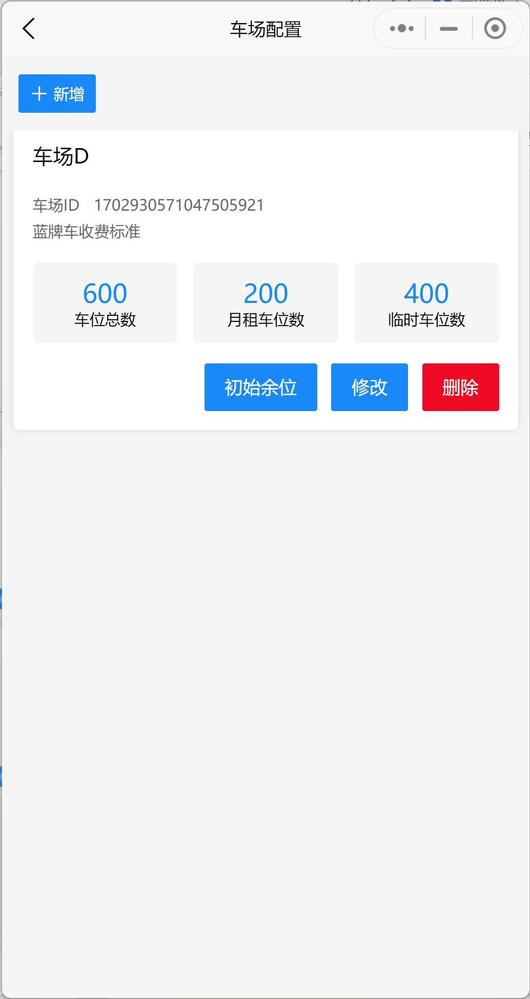

- 新增车场，不同车牌设置不同收费标准。
- 所属父车场：创建大小车场，输入大车场 ID。

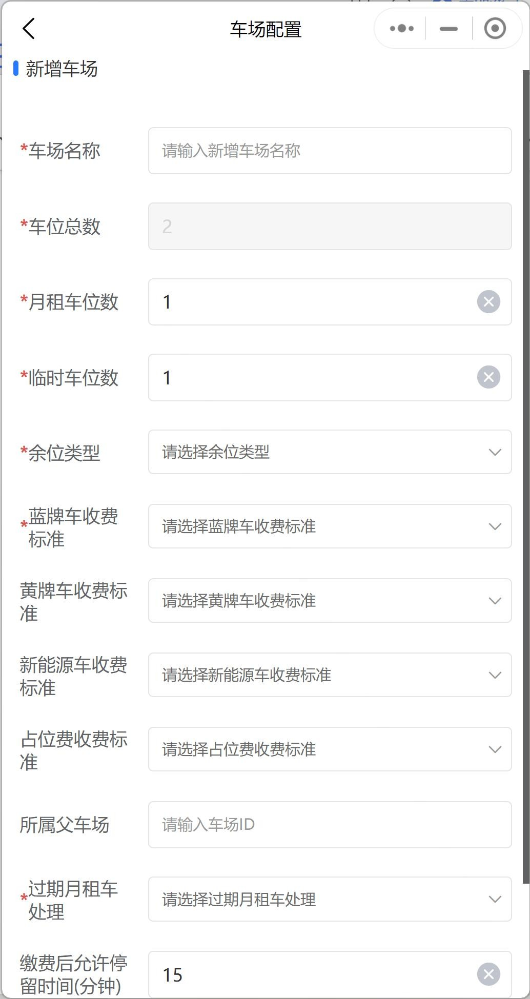

- 独立计算费用：默认开启，关闭后小车场不独立收费，统一到大车场出场收费。
- 过期月租车处理：共有七种过期车辆设置模式。

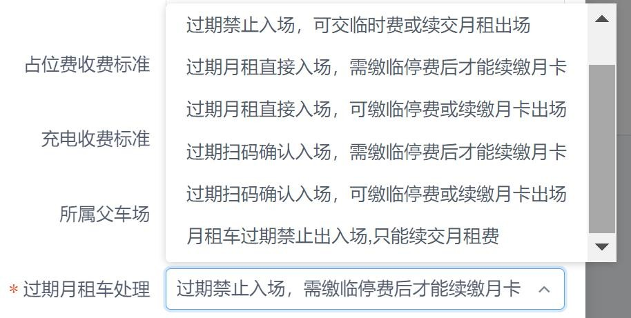

- 允许停留时间：支付识别开闸后允许停留时间。

### 5. 车道配置

- 新增车道类型分：入口、出口、入口虚拟、车位相机、共用闸机。

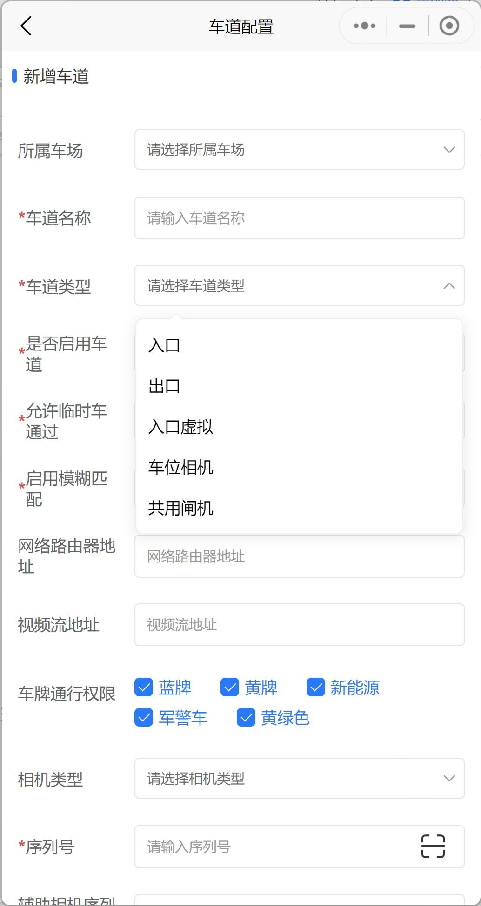

- 临时车通行方式。

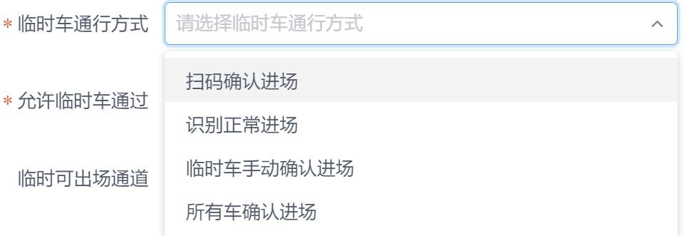

- 车牌通行权限：默认全部勾选，取消勾选对应类型车牌无法进出。
- 序列号可手动输入，也可扫一扫自动填充。
- 物联卡 ID：建议去营业厅开通，不会造成网速慢问题；插卡后与有线网实现双重保障，有线网断网后 10 秒开始启用物联卡，并发送通知到管理员公众号提醒。
- 相机授权：选择启用。
- 黄牌开双闸：根据不同车场设计，选择是否开启，默认为否。
- 车道类型选择出口时内容有所变动。

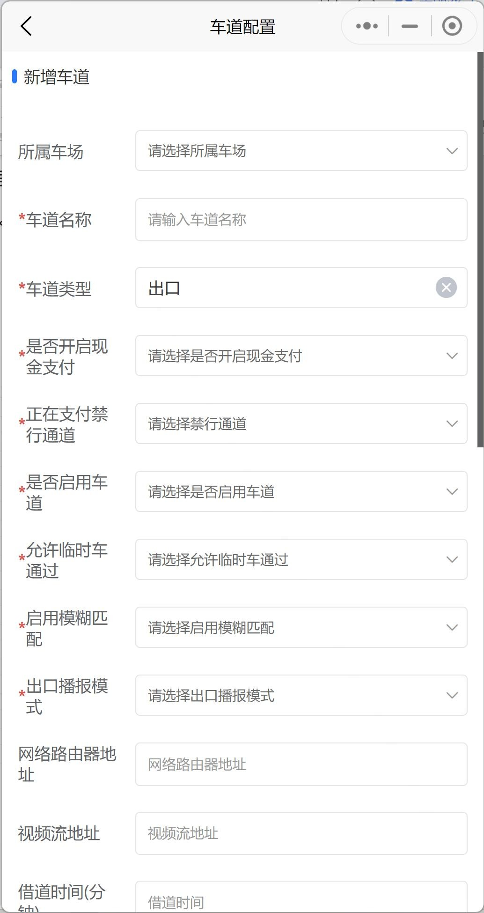

- 是否开启现金支付：配套岗亭端使用，可收现金。
- 正在支付禁行通道：使用场景同进同出，绑定后出口正在支付，入口来车会语音播报提示退后等待出口支付完成再入场。
- 设置借道时间、借道金额：在免费时间内生效，用于临时入场且停留时间较短的车辆。
- 车道配置好后设置滚动字幕，点击控制卡配置。
- 车牌识别方式：虚拟线圈与虚拟线圈加地感触发二选一，第二种情况有施工要求。
- 控制卡类型：控制卡对接了科发、DT、FK TTS 语音版。
- 动态二维码：显示屏可开启动态二维码，在二、三、四行显示。
- 延时关闸：开闸后无关闸信号可设置时间关闸。
- 有线网检测地址：填写当地宽带营业厅检测地址，例如电信填写 `114.114.114.114` 或 `223.5.5.5`，作为断网公众号通知提醒功能。
- 禁行时段：类型选择有临时车、所有车，添加的时间为禁行时段，从周一 0 时至周日 24 时，最小单位 30 分钟。

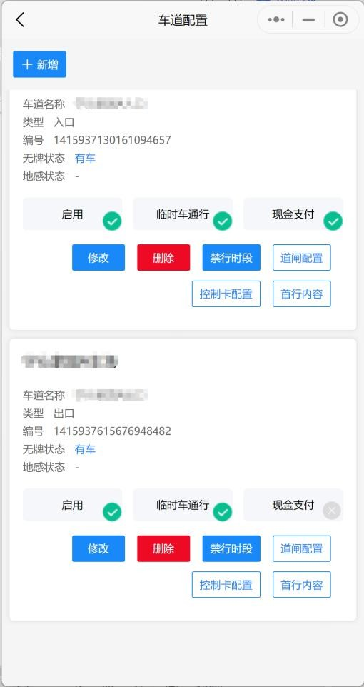

- 点击首行内容，可填写显示屏第一、二、三行内容，自定义文字。

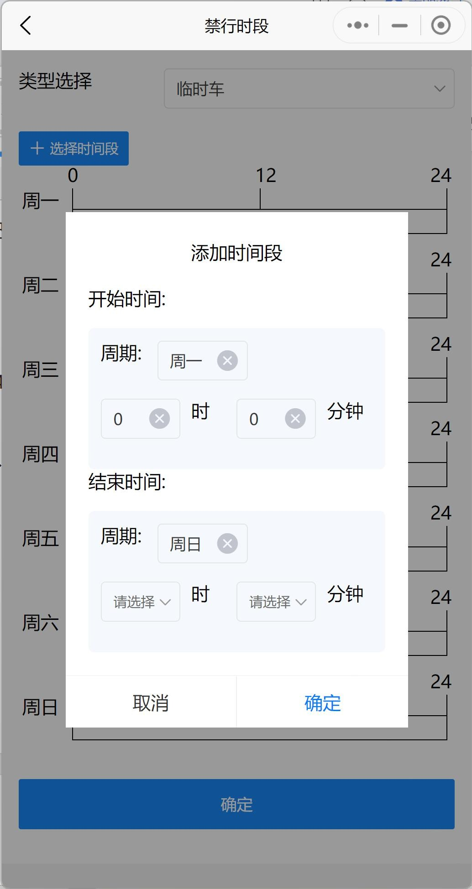

### 6. 公共配置

（1）公共配置主要对无牌车配置、月租车配置、入场配置、出场配置、支付配置、其它配置等。

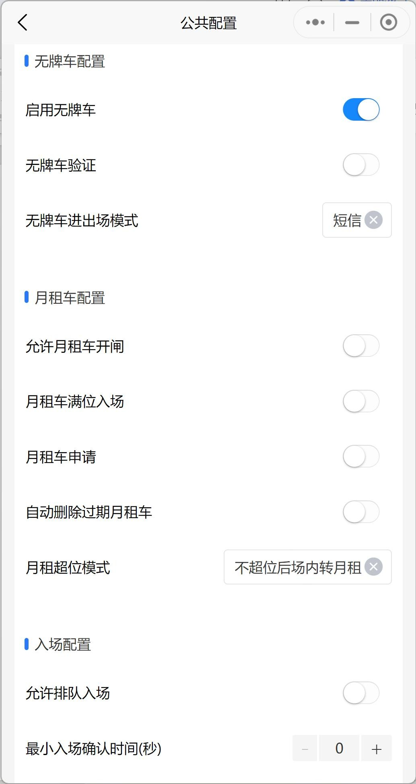

（2）无牌车配置：

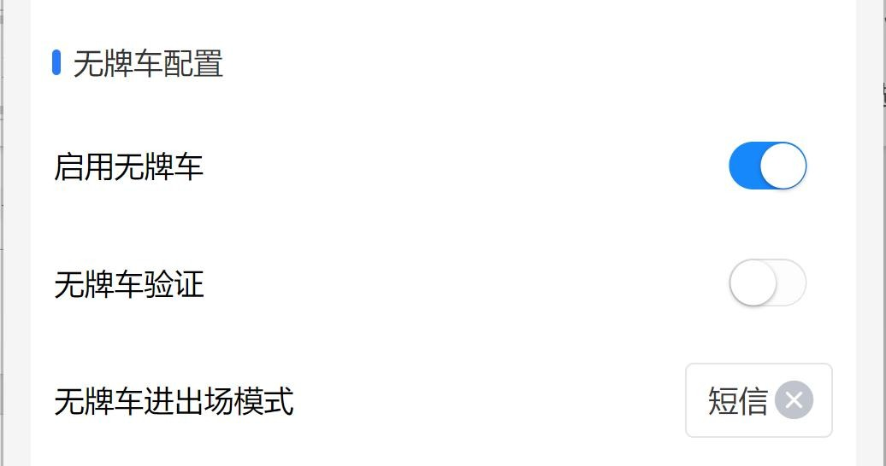

① 启用无牌车：开启后，无牌车可以选择扫码进出场。
② 无牌车地感验证：开启后现场有真实有效车辆才可触发无牌车开关，通过扫码不能直接开闸，避免车主用手机扫码输入、实际无车进场。
③ 无牌车进出场模式：小程序、短信、直接开闸三种模式，默认短信；小程序、短信均按 0.1 元/条收费，平台免费提供 100 条，后续自费。

（3）月租车配置：

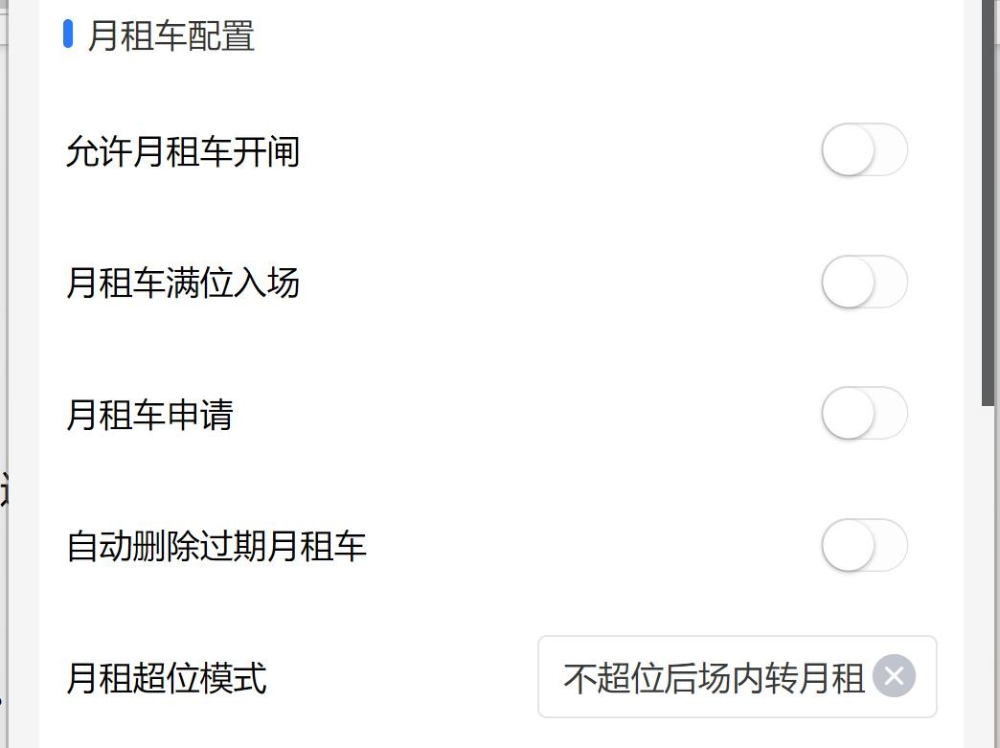

① 月租车满位入场：开启后，车场无余位情况下月租车仍正常入场。
② 自动删除过期月租车：默认开启 3 个月，超过设置时长自动删除。
③ 月租车申请：开启后，车主可自行扫车场月租申请码登记上报月租车信息。
④ 月租超位模式：在一位多车情况下，第二台（或多台）月租车要进车场，可选全程按临时车收费或场内转月租。

（4）入场配置：

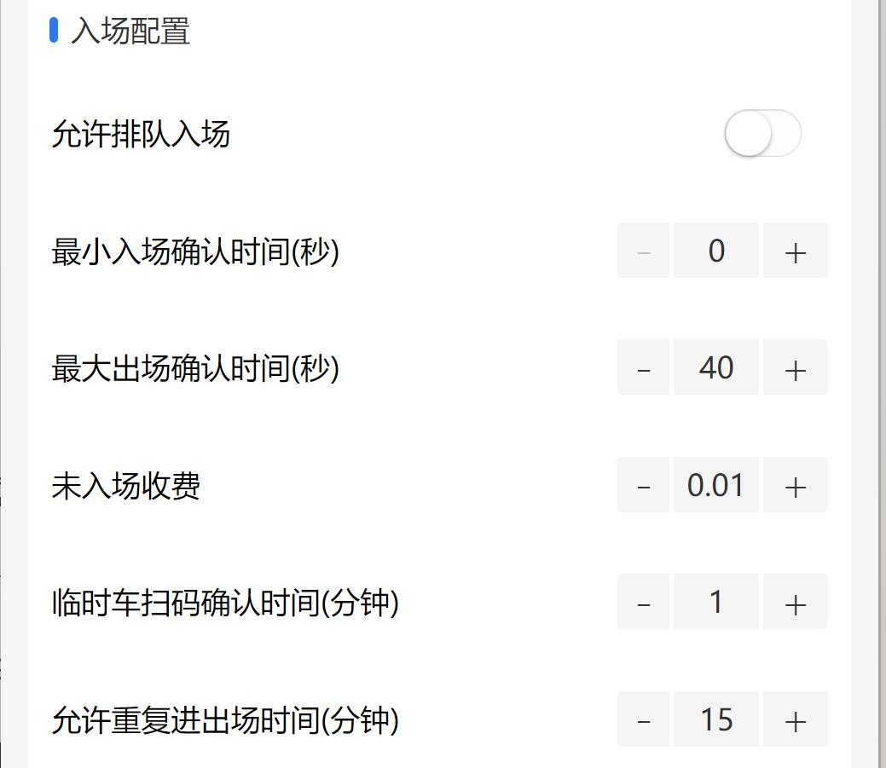

① 允许排队入场：默认开启，车位已满时车辆可在入口等待，出口有车出去后入口不用倒车、自动开闸。
② 最小入场确认时间：针对单通道，出场时避免车速过慢或车辆抖动重新识别尾部车牌造成异常开闸。
③ 最大出场确认时间：避免出口相机一直识别离出口较近停车位造成异常开闸，以及刚入场就到出口识别造成误识别。
④ 未入场缴费：没有入场记录，预支付指定保证金。
⑤ 临时车扫码确认时间：设置扫码支付时间，超时订单失效需重新扫码。
⑥ 允许重复进出场：例如缴费后道闸开闸时间已过、落闸后车辆后退重新识别又可重新开闸（举例：商户住店车在住店时间内可重复进出场）。

（5）出场配置：

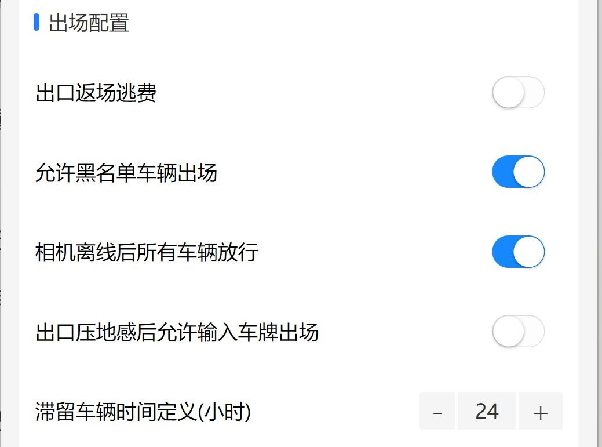

① 出口返场逃费：车辆入场后又到出口识别、再倒车停到车位；未开启时会丢失入场记录、提示无入场记录，此时系统提示缴纳保证金出场，不开启保证金模式则直接免费出场。
② 允许黑名单车辆出场：在场黑名单车辆允许出场。
③ 相机离线后所有车辆放行：默认不开，离线后管理员可用手机登录公众号、人工拍照上传照片进出（应对断电、断网状态）。
④ 出口压地感后允许输入车牌出场：用于扫码出场，避免利用相机识别照片错误开闸。
⑤ 滞留车辆时间定义：入场超过设定时间，自动归为滞留车辆、可手动盘存，该车辆不占用车场余位。

（6）支付配置：

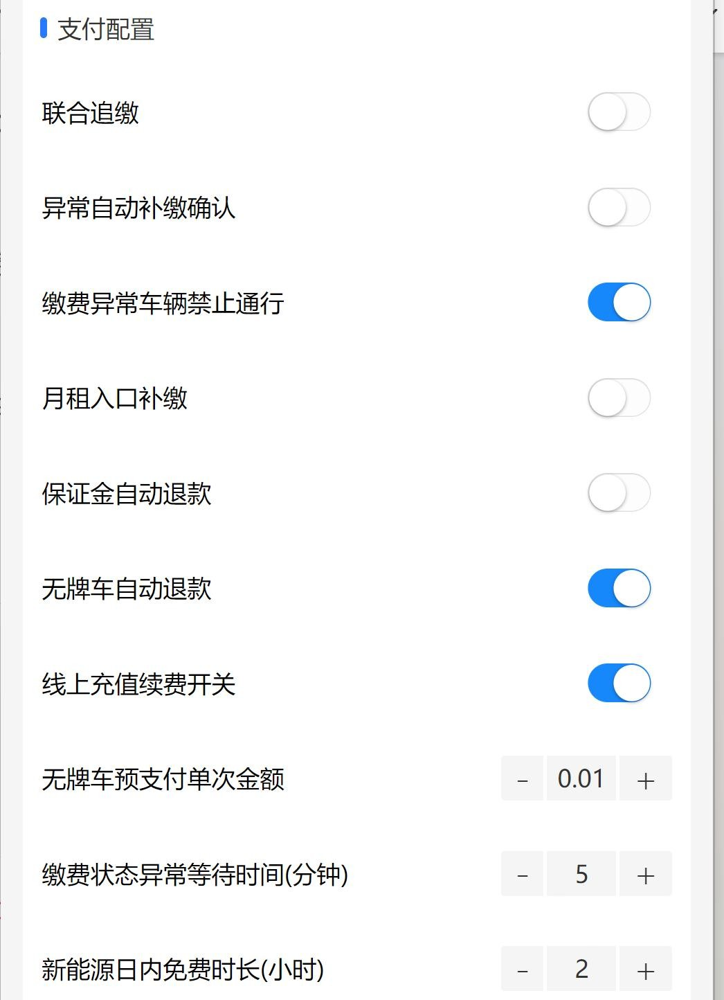

① 联合追缴：在同一账号下，A 停车场逃费记录上传云平台后，该城市所有车场可入口补缴该笔费用，金额回到 A 停车场账户。
② 异常自动补缴确认：开启后弹出自动补缴确认金额，小于等于填写金额的订单自动进入补缴后台，车辆再进入车场需补缴上次欠费订单后入场。
③ 月租入口补缴：开启后，过期月租出口未支付进入异常记录，确认补缴后待下次车辆入场需补缴上次欠费订单后再入场。
④ 保证金自动退款：开启后无入场记录车辆出场的保证金隔天自动退款。
⑤ 无牌车自动退款：开启后无牌车预付金额在车辆出场后隔天自动退款。
⑥ 无牌车预支付单次金额：填写金额（元），无牌车扫码进入需交预付保证金。
⑦ 缴费状态异常等待时间：出入口识别车牌后，在设定时间内不扫码支付则需重新后退识别。
⑧ 自动补缴确认金额：功能属于异常补缴确认功能的补充项。
⑨ 新能源日内免费时长（小时）：设置新能源车辆指定时长内免费通行。

- 其它配置：

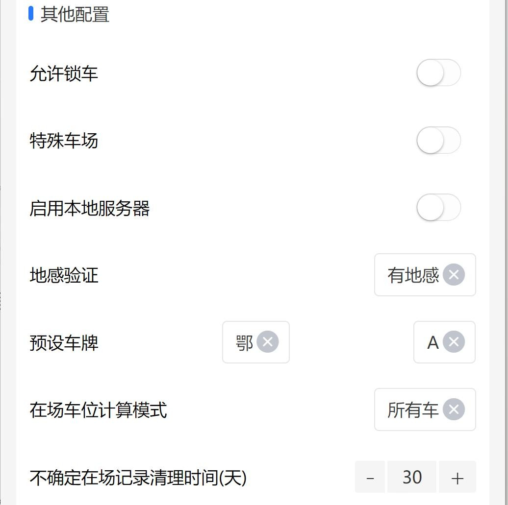

① 允许锁车：开启后月租车可设置开闸密码，进出需扫码填写密码开闸；未设密码则自动识别出场。
② 特殊车场：针对相机无法识别牌照的特殊车场，默认不开启。
③ 地感验证：辅助识别功能，默认不开，详情可咨询停车Boss公司技术人员。
④ 预设车辆：提高相机识别率与识别速度，提前设置该城市车牌文字。
⑤ 在场车辆计算模式：扫码车辆或总车辆。
⑥ 不确定在场记录清理时间：不确定在场自动删除入场记录。

- 音量及广告页面配置：

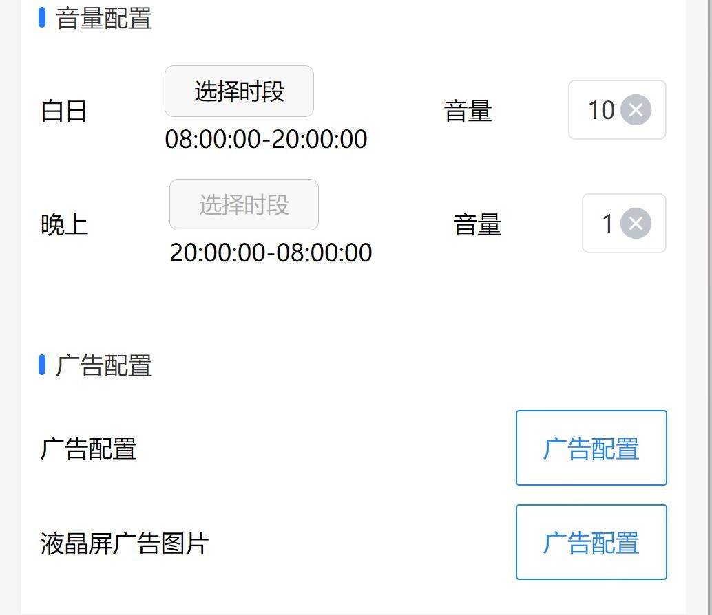

① 音量设置：设置白天与晚上不同时间播报音量。
② 广告配置：配置后所有扫码页面生效。
③ 液晶屏广告图片：配置后显示在液晶屏上。

### 7. 二维码配置

- 创建车道后生成对应二维码：预支付码、入口码、出口码、月租申请码。二维码查看弹窗，点击生成图片并下载，直接下载到本地。

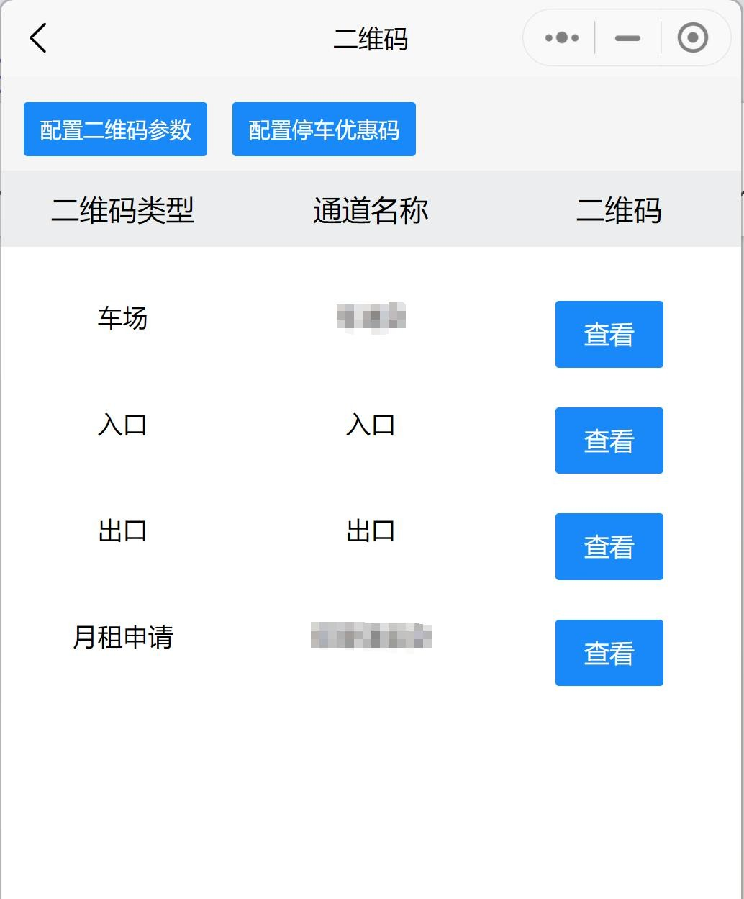

- 预付折扣码：点击【配置停车优惠码】，选择车场、收费标准，点击确认，生成预付折扣码二维码，点击【生成图片并下载】供打印使用。

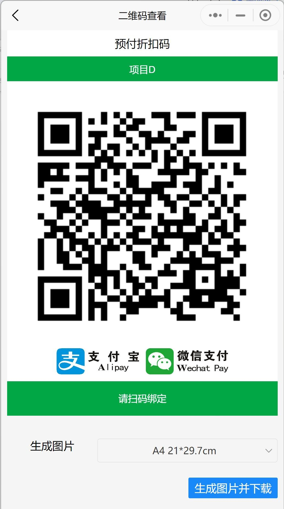

### 8. 相机配置

相机状态绿色代表在线，红色代表掉线；点击主相机进入相机网页端调试界面。

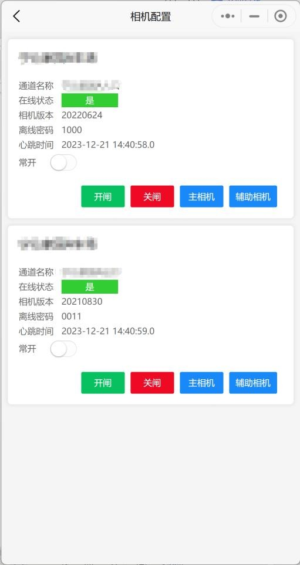

### 9. 商户管理

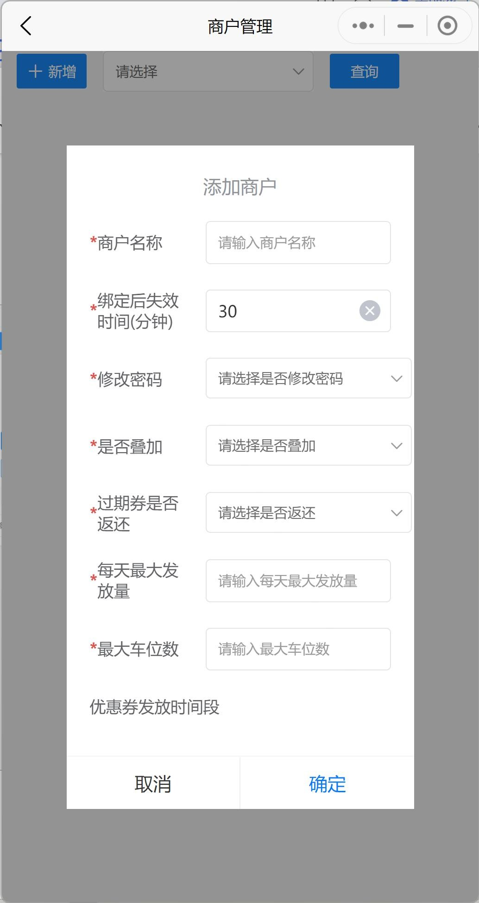

- 绑定后失效时间：指定车牌发券、公众号动态券的有效时间。
- 是否叠加：同一类型优惠券可选择是否叠加使用（例如小时券、金额券）。
- 过期是否返还：券设置有效期内未使用是否返还到券库存。
- 每天最大发放量：例如金额券，避免浪费。
- 最大车位数：各个商户最大车位数量。
- 优惠券发放时间段：针对各类商户使用时间设置。
- 酒店有住店车、钟点房情况，设置离店过夜以及钟点房时间。
- 车主自助购买：开启状态需车主自行扫码购买优惠券，默认关闭。
- 添加商户后可查询、修改、删除商户。
- 先添加优惠券套餐，再绑定套餐，选择对应套餐进行充值。
- 发放方式有：指定车牌、批次券发放、宴会券发放。

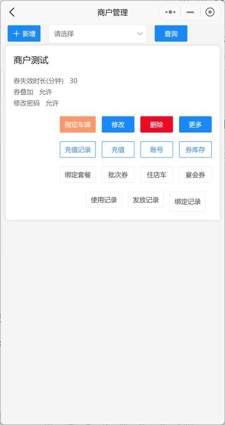

### 10. 优惠券配置

- 设置优惠券套餐：有 7 种券类型——时长券、金额券、次券、住店券、定额券、定时券、折扣券。

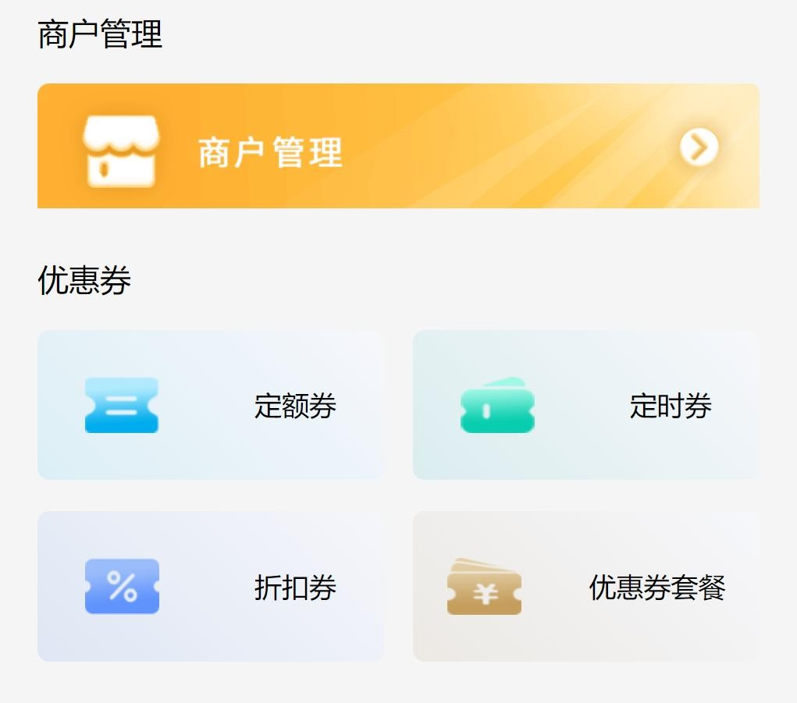

① 时长券、定时券按时间优惠，区别在于定时券为定制券，设置的优惠时间是固定的。
② 金额券、定额券按金额抵扣优惠，区别在于定额券为定制券，设置固定的金额面值。
③ 次券：按次免费。
④ 折扣券：打折券。
⑤ 住店券：住店消费，免费停车。

- 优惠券统计：统计当前车场商户券的使用情况。

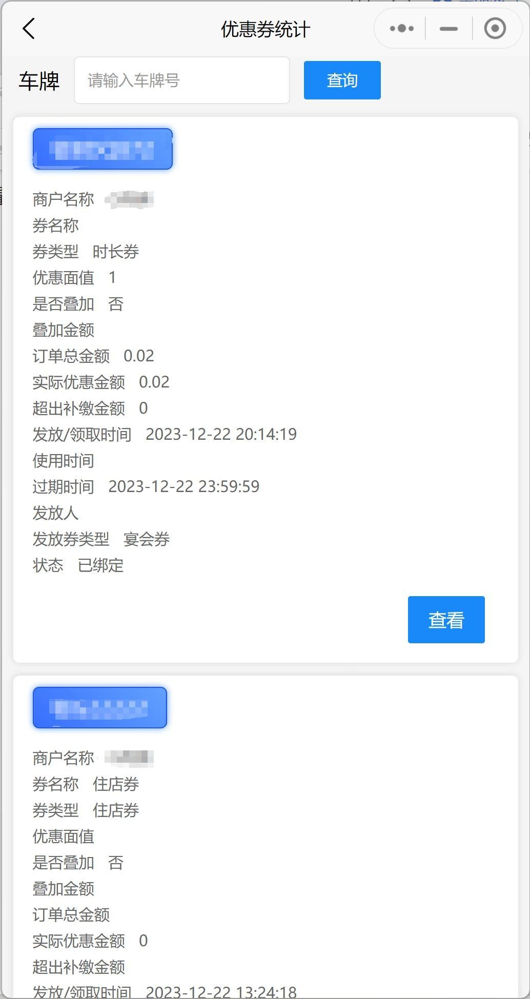

## 三、车场数据查询

当前车场可从配置的项目列表点击项目名称跳转至车场，自动切换项目名。

### 1. 设备管理

- 进入设备管理，可查看车场设备在线状态、心跳时间、操作开关闸、预览视频，手动输入车牌入场、手动选择车牌出场。

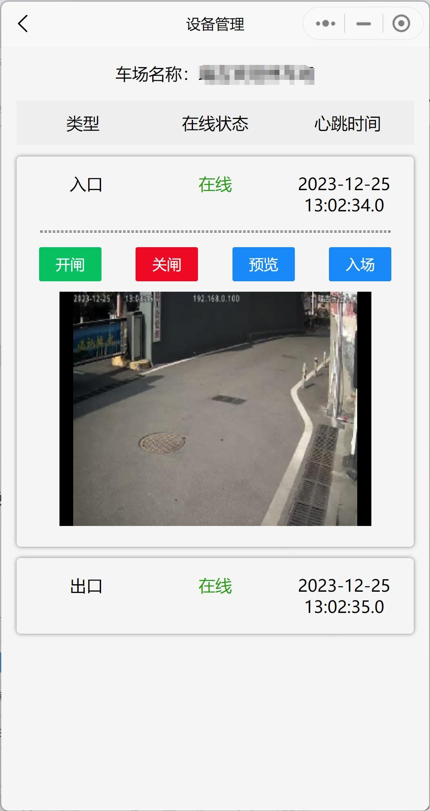

- 手动出/入场场景（断电、断网状态）：相机离线后所有车辆放行，车场管理员拍照上传照片入场。

### 2. 车辆管理

- 添加月卡车，车辆类型有月租车、临时车、储值车、免费车、时段限制月租。
- 可对添加成功的车辆进行【修改】、【查询】、【删除】操作，月租车可操作【延期】。
- 车主管理：因车主存在多辆车、多个车位的情况，可在车主列表用户下添加车辆，设置是否超位入场、是否一位多车。

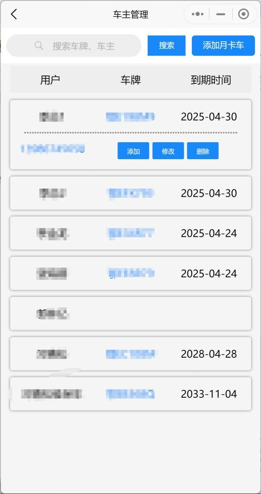

### 3. 预付退款

无牌车手动申请退款列表，点击【退款】，输入退款原因并提交。

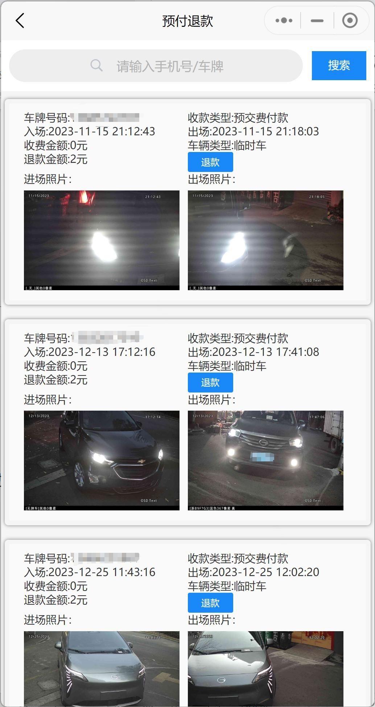

### 4. 滞留盘点

入场车辆超过设定时间，自动归为滞留车辆，可手动盘存，该车辆不占用车场余位。

### 5. 在场车辆

可搜索在场车牌，手动添加车牌、修改车牌，查看在场月租、临时车、余位数量。

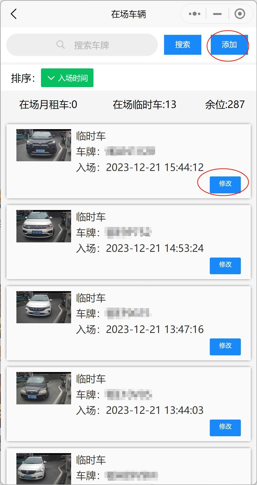

### 6. 进出记录

可搜索车牌，查看车辆进、出时间、停留时长、收款类型等信息。

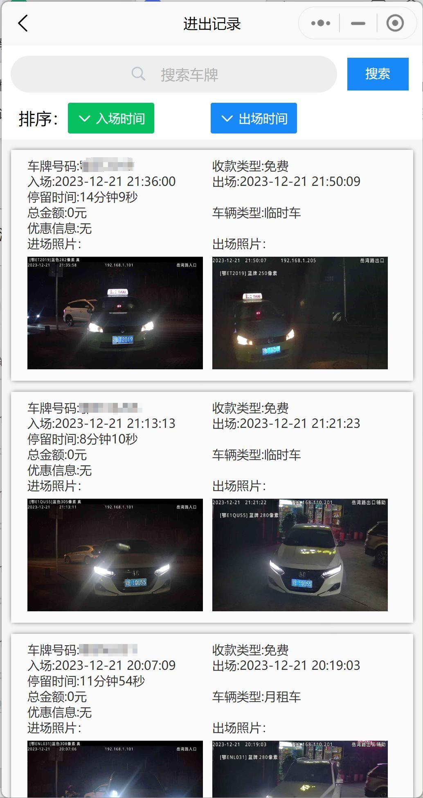

### 7. 支付记录

可搜索车牌，查看车辆支付金额、支付类型等。

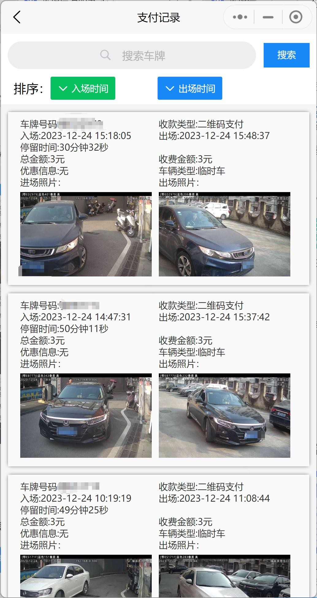

### 8. 预约车辆

针对商户使用，预约对象为商户，商户可自行填写预约车辆信息。

### 9. 黑名单

可输入黑名单车牌或车主电话号码，列入黑名单的车辆入场时需车场管理员确认。

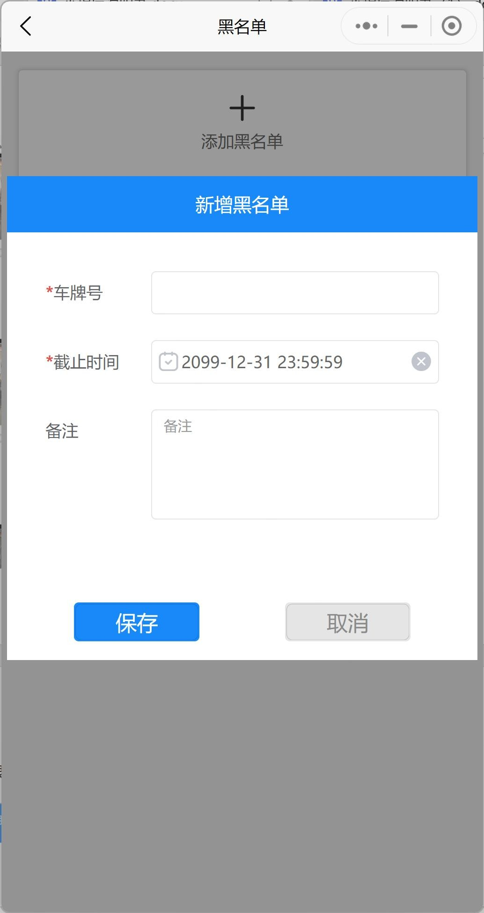

### 10. 统计报表

可切换数据表和柱状图，还可分为周报、月报。

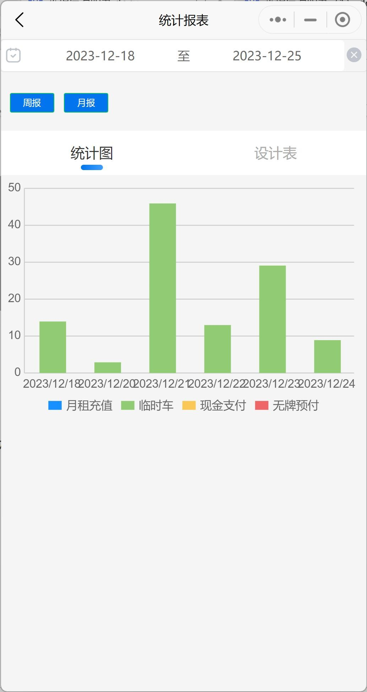

## 四、我的

可操作修改登录密码、切换账户、问题反馈。

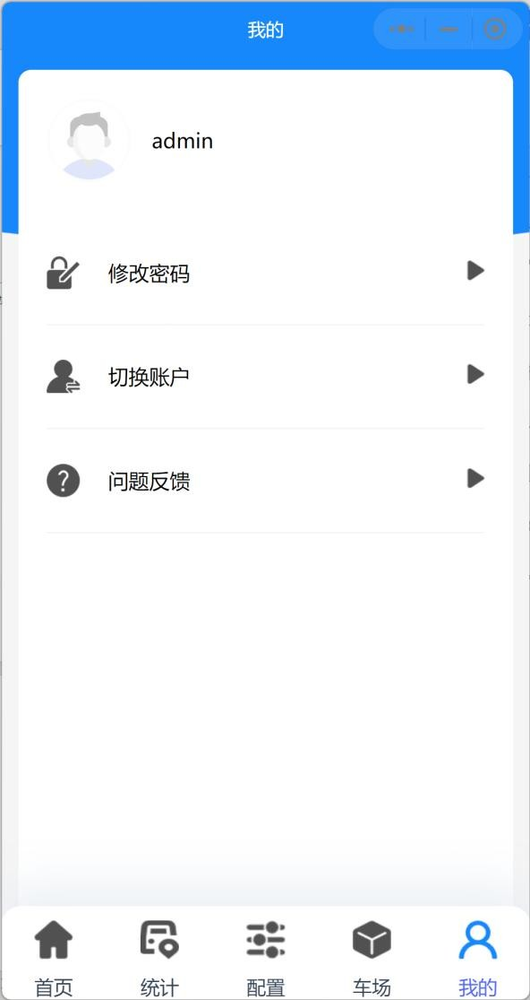

