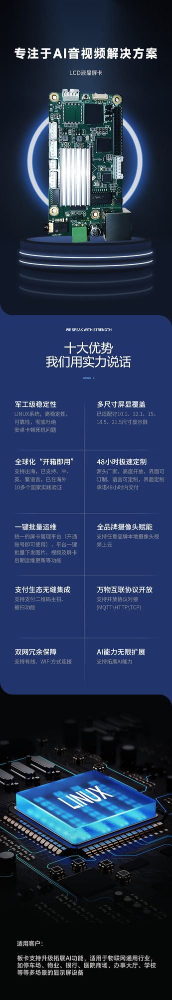
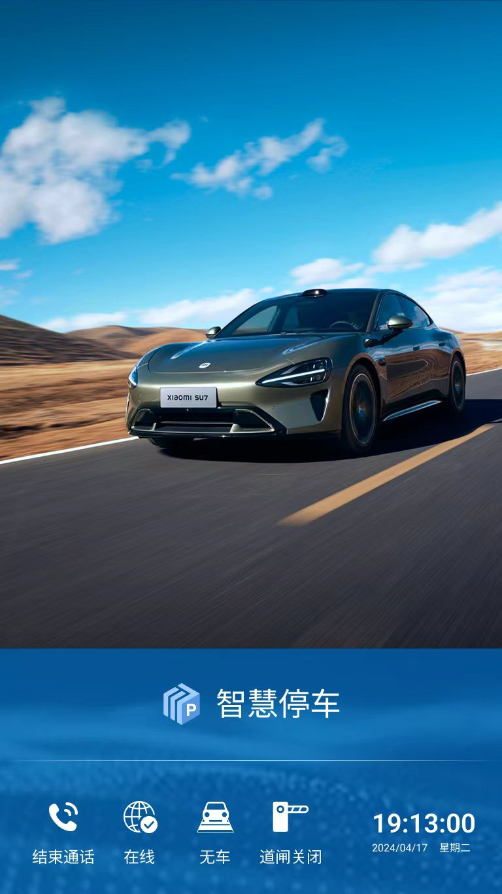

# 显示屏系统

:::tip 核心功能
LED 显示屏用于显示车牌号、欢迎语、收费金额、车位引导等信息，是无人值守停车场的**重要交互界面**。
:::

## 产品介绍

### 主要特性

- **高亮度显示**：户外可见，阳光直射下清晰显示
- **多色显示**：支持红、绿、黄等多色文字
- **远程下发**：通过云平台远程更新显示内容
- **多行显示**：支持 2~4 行文字同时显示
- **语音同步**：显示屏与语音播报同步

## 显示效果

### 界面效果图一

### 界面效果图二

### 界面效果图三

## 技术参数

| 参数 | 规格 |
|------|------|
| 显示颜色 | 红/绿/黄/全彩 |
| 点阵规格 | 常见 32×16、64×32 |
| 亮度 | ≥5000 cd/m²（户外） |
| 可视距离 | 10m ~ 50m |
| 刷新率 | ≥300Hz |
| 工作电压 | DC 5V / 12V |
| 通讯方式 | RS485 / 以太网 / WiFi |
| 工作温度 | -20℃ ~ +60℃ |
| 防护等级 | IP65 |

## 安装规范

### 安装位置

:::tip 推荐安装方式
- **安装高度**：离地 **2.5m ~ 3.5m**，确保驾驶员清晰可见
- **安装角度**：略微下倾 5° ~ 15°，避免反光
- **安装位置**：道闸前方或侧方，正对驾驶员视线
:::

### 接线规范

| 接口 | 接线说明 |
|------|----------|
| 电源 | DC 5V/12V，注意功率匹配 |
| RS485 | A/B 线连接主板或控制器 |
| 以太网 | 网线连接交换机 |

## 显示内容配置

### 常用显示模板

| 场景 | 显示内容示例 |
|------|--------------|
| 入场欢迎 | 欢迎光临 / 车牌号 / 入场时间 |
| 出场收费 | 车牌号 / 停车时长 / 缴费金额 |
| 月卡用户 | 月卡有效 / 车牌号 / 有效期 |
| 车位满 | 车位已满 / 请绕行 |
| 临时提示 | 系统维护 / 请扫码缴费 |

### 远程下发流程

1. 登录云平台
2. 进入"显示屏管理"模块
3. 选择目标显示屏设备
4. 编辑显示内容（支持变量：车牌号、时间、金额等）
5. 点击"下发"，内容实时更新

## 常见故障排查

| 现象 | 可能原因 | 处理方法 |
|------|----------|----------|
| 屏幕不亮 | 电源故障 / 接线松动 | 检查电源，测量电压 |
| 显示乱码 | 通讯故障 / 波特率错误 | 检查 RS485 接线，核对波特率 |
| 部分不亮 | LED 灯珠损坏 | 联系厂家更换模组 |
| 显示模糊 | 亮度太低 / 视角不对 | 调整亮度，调整安装角度 |
| 内容不更新 | 网络故障 / 下发失败 | 检查网络，重新下发 |

## 相关文档

- [对讲卡系统](../intercom-card) - 云对讲核心设备
- [对讲话机](../intercom-phone) - 话机配置与使用
