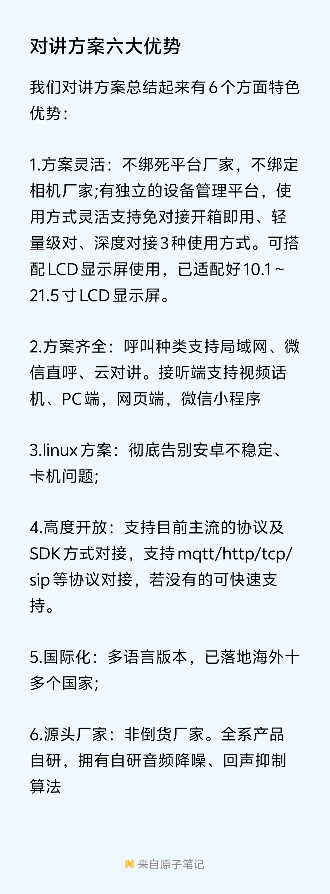

# 无人值守停车场解决方案

:::tip 核心价值
无人值守停车场通过**车牌识别 + 云对讲 + 移动支付 + 远程管控**，实现车场 24 小时无人化管理，降低人工成本，提升通行效率。
:::

## 方案组成

无人值守方案由以下核心模块组成：

| 模块 | 功能 | 关键设备 |
|------|------|----------|
| **车牌识别** | 车辆进出自动识别抬杆 | 车牌识别相机、补光灯 |
| **云对讲** | 车主远程呼叫管理中心 | 对讲卡、对讲话机 |
| **移动支付** | 微信/支付宝/无感支付 | 聚合支付码、小程序 |
| **远程管控** | 云端开闸、异常处理 | 云平台、移动端 APP |
| **防砸保护** | 雷达/地感/红外多重防护 | 毫米波雷达、地感线圈 |

## 六大优势

:::info
1. **降低人工成本**：无需 24 小时岗亭值守，一个管理中心可管控多个车场
2. **提升通行效率**：车牌识别秒级抬杆，无需停车取卡/取票
3. **杜绝收费漏洞**：电子支付全程留痕，避免人工收费差错
4. **提升车场形象**：现代化智能管理，增强用户停车体验
5. **数据实时同步**：云端统一管理，财务报表实时可查
6. **远程应急响应**：异常情况下车主可一键呼叫远程客服
:::

## 典型应用场景

- **商业停车场**：购物中心、写字楼、酒店
- **住宅社区**：小区地下车库、地面停车位
- **公共停车**：医院、学校、政务中心
- **产业园区**：科技园、工业园、物流园
- **路侧停车**：城市道路泊位、景区停车位

## 相关文档

- [对讲卡与话机系统](./intercom-card) - 云对讲核心设备
- [显示屏系统](./display-screen) - 车位引导与信息发布
- [硬件防砸](../hardware/anti-crash/3) - 雷达毫米波防砸方案
