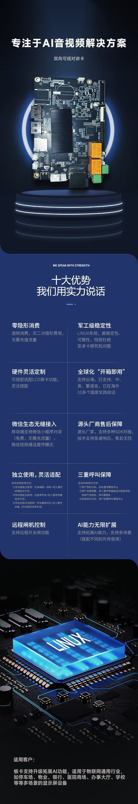
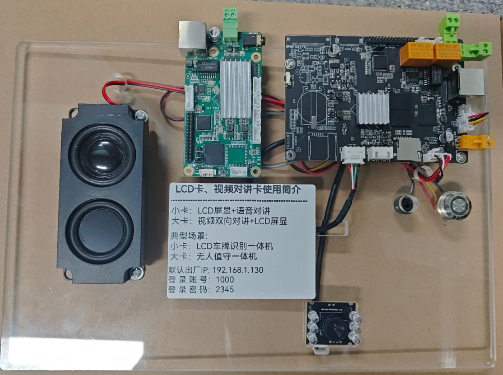
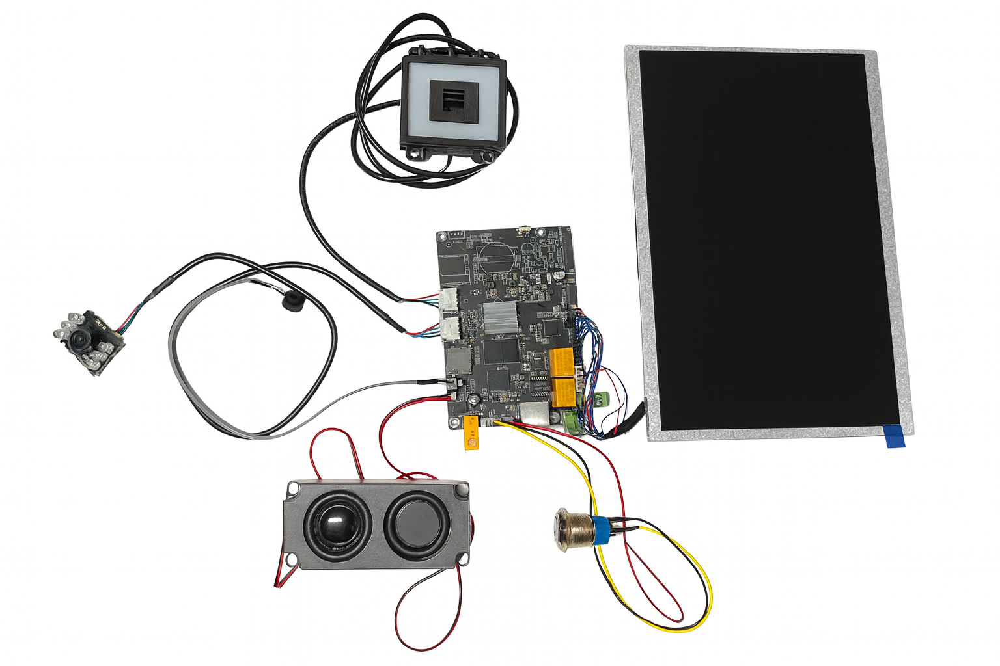

# 对讲卡系统

:::tip 核心功能
对讲卡是无人值守停车场的**云对讲核心设备**，实现车主与管理中心的语音通话，支持远程开闸、异常处理等功能。
:::

## 产品介绍

### 主要特性

- **双模式支持**：云模式（4G/WiFi）+ 局域网模式
- **高清音质**：全双工语音通话，回声消除
- **一键呼叫**：车主按按钮即可呼叫管理中心
- **远程开闸**：管理中心可远程确认并开闸
- **低功耗设计**：待机功耗低，适合 24 小时运行

## 卡简要介绍

### 技术参数

| 参数 | 规格 |
|------|------|
| 工作电压 | DC 12V |
| 工作电流 | 待机小于 50mA，通话小于 200mA |
| 通讯方式 | 4G / WiFi / 以太网 |
| 音频采样 | 16kHz / 8kHz |
| 工作温度 | -20℃ ~ +70℃ |
| 防护等级 | IP65 |

## 完整接线实物图

### 接线说明

1. **电源接口**：DC 12V 电源输入
2. **4G 天线**：外接 4G 天线（云模式）
3. **WiFi 天线**：内置或外接 WiFi 天线
4. **话机接口**：连接对讲话机（RJ11/RJ45）
5. **开闸输出**：继电器干接点，连接道闸主板
6. **网络接口**：以太网口（局域网模式）

## 规格书下载

:::info 文档下载
- [对讲板规格书 V1.0](/files/unattended/对讲板规格书-V1.0.pdf)
:::

## 相关文档

- [对讲话机使用手册](../intercom-phone) - 话机配置与使用
- [显示屏系统](../display-screen) - 车位引导与信息发布
